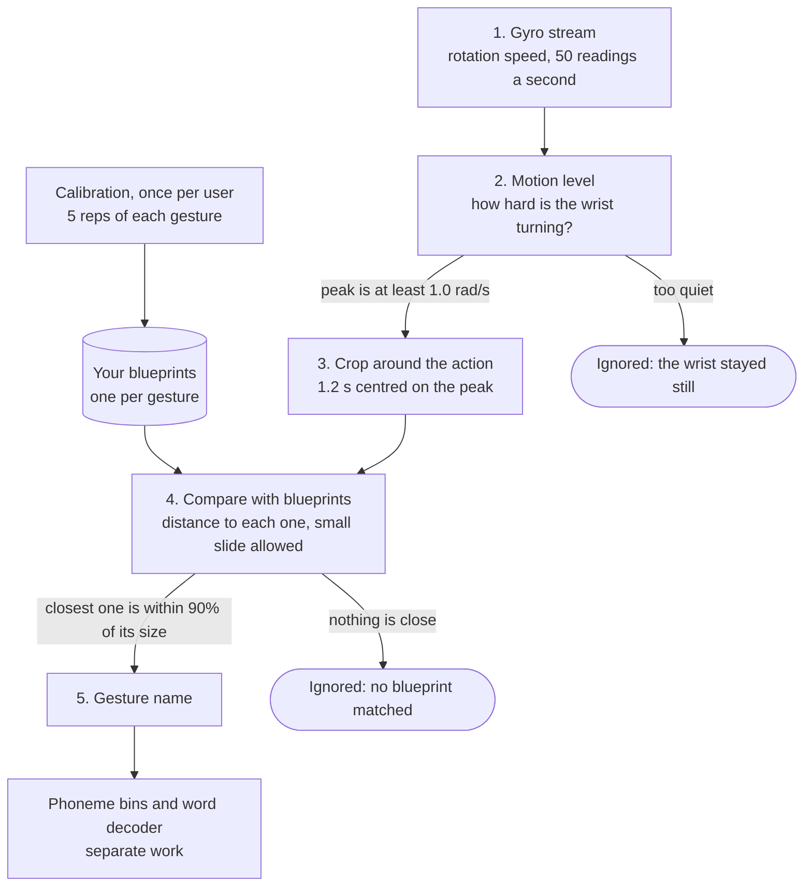
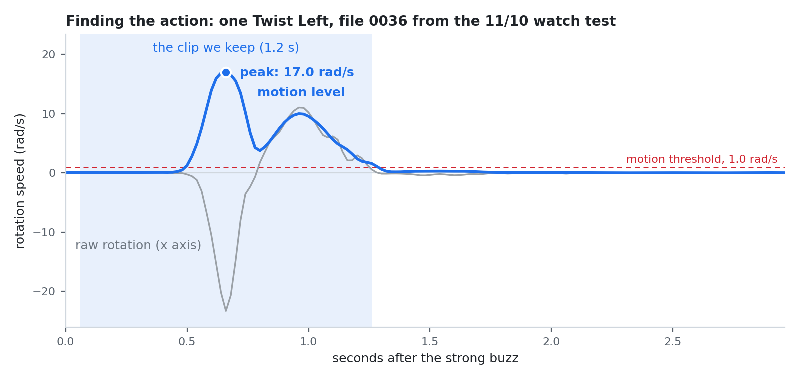
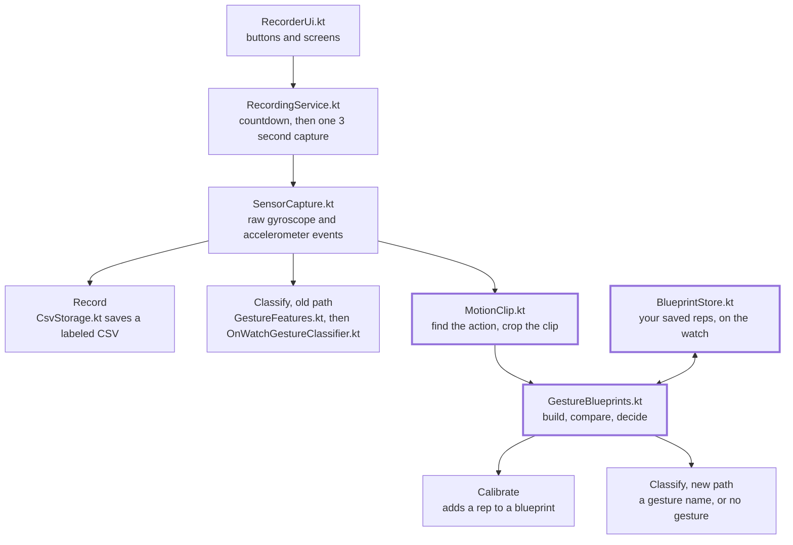

# Tactura gesture recognition v2: implementation plan

Russell Mehta. Written Nov 10, 2026. Last updated Nov 11, 2026.

> **Where the build stands (Nov 11).** Phases 0 and 1 are done. Phase 2 runs on the Galaxy Watch 7: calibration, blueprint Classify and the "no gesture" answer all work. The **Wrong?** correction is not built yet, and nothing from phases 3 to 5 is started. The diagrams and formulas in this file render on GitHub.

## The one-minute version

We are replacing the 500-tree model with personal gesture blueprints that the watch learns from each user in about three minutes.

- **The problem.** The current model learned how the recorder held his arm, not the gestures. On a new person it scored 25 of 51 (49%). It also named a gesture for a motionless arm every single time.
- **The fix.** Each user shows the watch every gesture a few times. The watch saves one blueprint per gesture, then matches each new movement to the closest blueprint.
- **Two rules make it work.** Look only at motion, never at arm angle. Line every movement up in time before comparing.
- **What it scored.** Built from only 3 of Russell's reps per gesture, it got about 96% on his remaining gestures in laptop tests.
- **On the watch.** With Russell's own blueprints the watch named 41 of 50 gestures correctly and gave zero wrong names. The old model got 25 of 51 with 26 wrong names.
- **What stays.** The recording app, the CSV format, the capture timing and every existing file stay. The new pieces sit beside the current classifier until they prove themselves.

These numbers come from two people and one evening of testing. Treat them as a strong signal, not a final result.

## What we found

The current model works exactly as coded, but it learned the wrong thing: the resting arm angle of each recording batch. The full write-up is `claude/classifier-diagnosis-2026-11-10.md`, a doc in the Tactura project on claude.ai. It is not in this repo. The short version is below.

**The watch app itself is fine.** Dhruv's 11/9 fix made Classify see the same input as training. Re-running all 77 of Russell's watch windows through the laptop model gave the same answer 77 of 77 times. The ONNX file matches the joblib file to six decimal places.

**The training data has a hidden shortcut.** All 250 recordings were made by one person on one evening, 50 of one gesture and then 50 of the next. The arm rested at a slightly different angle in each batch. The accelerometer measures gravity, so it records that angle.

| Test on the 250 training recordings | Accuracy |
| --- | --- |
| Shuffled split (looks great, but misleading) | 96% |
| Train on each gesture's first 35, test on its last 15 | 75% |
| Using only the first 0.2 s, before any gesture starts | 80% |
| Using only the last 1 s, after the gesture is over | 85% |

Guessing would score 20%. A model that scores 80% before the gesture begins is reading the arm, not the motion.

**The watch test confirmed it.** Russell wore the Galaxy Watch 7 on his left wrist and ran 51 labeled gestures plus 20 still-arm windows.

| What Russell did | What the watch said |
| --- | --- |
| Flick Up, 10 times | Correct 10 of 10 |
| Flick Down, 10 times | Correct 0 of 10 |
| Twist Right, 10 times | Correct 3 of 10 |
| Twist Left, 11 times | Correct 9 of 11 |
| Shake, 10 times | Correct 3 of 10 |
| Arm tilted, no motion, 10 times | "Flick Down" 10 of 10 |
| Arm flat on desk, no motion, 10 times | A twist every time, twice above 97% confidence |

**Each fix we tried, on Russell's data.**

| Approach | How it was tested | Accuracy |
| --- | --- | --- |
| Current forest | Trained on Dhruv, tested on Russell's 51 | 49% |
| Forest with the accelerometer hidden | Same | 73% |
| Blueprints, compared slot by slot | Russell's first 3 reps, tested on his other 36 | 64% |
| Blueprints, frequency fingerprint | Same | 97% |
| Blueprints, cropped around the action with a small slide | 3 random reps, tested on the rest, averaged over 20 draws | 96%, worst draw 94% |

**People do the gestures differently.** Russell's shake rotates about five times faster than Dhruv's (about 37 against 8 rad/s). His flick down registers on the twist axis. A blueprint built from Russell's shakes matched 0 of 50 of Dhruv's. This is why one shared model struggles and personal blueprints do not.

**The new recipe on the watch (11/10, late evening).** Russell calibrated 5 gestures with 5 reps each in 3 minutes 16 seconds, then ran the same scorecard as before.

| What Russell did | Old model, 7:15 pm | His blueprints, 10:48 pm |
| --- | --- | --- |
| Flick Up | 10 of 10 | 10 of 10 |
| Flick Down | 0 of 10 | 10 of 10 |
| Twist Right | 3 of 10 | 10 of 10 |
| Twist Left | 9 of 11 | 10 of 10 |
| Shake | 3 of 10 | 1 of 10, the other 9 ignored |
| Gestures given a wrong name | 26 | 0 |
| Still arm named as a gesture | 20 of 20 | 1 of 11, a faint twitch, fixed by lowering the limit to 90% |

The blueprints also held across sittings. Applied to the windows recorded three hours earlier, they named 41 of 41 flicks and twists correctly and ignored 20 of 20 still-arm windows. The watch and the laptop gave identical answers on all 69 windows from the evening test.

Shake failed because it is not one motion yet. Russell's shakes ranged from 0.8 to 4 wiggles per second and from 16 to 37 rad/s over the evening. Calibration now checks that each rep can be recognised from the other four, drops the odd one out, and asks for another.

**After pinning shake down (11/10, 11 pm).** Shake was defined as "3 quick wiggles" and recalibrated on its own. In the next round the watch got 26 of 31 right: Shake 7 of 10, Flick Up 5 of 5, Flick Down 4 of 5, Twist Left 5 of 5 and Twist Right 5 of 6. Four real gestures were ignored and one shake was named Twist Left. The wording "3 quick wiggles" is a placeholder until the team agrees on a definition.

## The new idea in plain words

The watch should recognise your gestures the way a bank recognises your signature: by comparing against samples you gave it.

| The bank | Tactura |
| --- | --- |
| You sign a few times when you open the account. | You do each gesture a few times when you first open the app. This is calibration. |
| A new signature is compared with your samples. | A new movement is compared with your saved blueprints. The closest one wins. |
| It does not matter where on the page you sign. | It does not matter whether you start the gesture early or late. The watch lines things up first. |
| The colour of the paper is ignored. | The resting angle of your arm is ignored. Only motion counts. |
| A scribble that matches nothing is rejected. | A movement that matches no blueprint is ignored. So is a still arm. |

**The recipe in four steps**

1. **Look only at motion.** Use the gyroscope (how fast the wrist is rotating). Leave out the accelerometer, because it carries the arm angle.
2. **Find the action and crop around it.** Locate the moment the wrist moves the most. Keep a short clip centred on that moment.
3. **Average a few reps into a blueprint.** One blueprint per gesture, per person.
4. **Pick the closest blueprint, or say nothing.** If no blueprint is close, or the wrist never moved much, the answer is "no gesture".

**Why not just retrain the forest?**

- It needs many varied recordings from many people to stop finding shortcuts. We have four people.
- It has five possible answers and cannot say "nothing happened".
- It is trained on a laptop, converted, and bundled into the app. Blueprints are learned on the wrist.

The forest stays in the app for now so we can compare the two side by side.

## The pipeline

Every movement passes two gates before it gets a name: it must be loud enough, and it must match one of your blueprints.



Read it top to bottom. Calibration happens once and feeds the blueprints. The numbered steps happen for every movement.

1. **Gyro stream.** The watch reads rotation speed 50 times a second. In the button version this is the 3 second window the app already captures. In real-time mode it is a rolling buffer.
2. **Motion level.** One number that says how hard the wrist is turning. A still arm stays near zero, so it stops here and is ignored.
3. **Crop around the action.** Keep 1.2 seconds centred on the loudest moment. Early or late no longer matters.
4. **Compare with blueprints.** Measure how far the clip is from each blueprint, allowing a small slide. If nothing is close, it is ignored.
5. **Gesture name.** The closest blueprint wins. The name then goes to the phoneme bins and the word decoder, which are separate work.

The math for each box is in the next section.

## The math, step by step

Every step is plain arithmetic: add, average, subtract, compare. Each one has a sentence, a formula, and the number we tested with.

**What the watch gives us.** Fifty times a second, the gyroscope reports how fast the wrist is rotating around three axes, in radians per second. One reading is three numbers. A 3 second window is 150 readings.

```math
g_t = \left(g^{x}_t,\; g^{y}_t,\; g^{z}_t\right)
```

### Step 1. Motion level

How hard is the wrist turning right now? Square the three numbers, add them, average over a short stretch, and take the square root. The averaging stops one jittery reading from looking like a gesture.

```math
m_t = \sqrt{\frac{1}{W}\sum_{k=-3}^{3}\lVert g_{t+k}\rVert^{2}}, \qquad W = 7 \text{ readings} = 140 \text{ ms}
```

### Step 2. Find the action

The action is where the motion level peaks. If even the peak is quiet, nothing happened.

```math
t^{*} = \arg\max_t \, m_t, \qquad \text{gesture present only if } m_{t^{*}} \ge \theta, \quad \theta = 1.0 \text{ rad/s}
```

Measured: Russell's still arm never went above 0.44 rad/s. The gentlest real gesture from either person reached 1.68. The threshold sits in the gap.

### Step 3. Crop

Keep 30 readings before the peak and 30 after. That is 1.2 seconds on three axes, so every clip is a list of 180 numbers with the big swing in the same place.

```math
x = \left(g_{t^{*}-30},\; \dots,\; g_{t^{*}+29}\right) \in \mathbb{R}^{180}
```



The grey line is the raw rotation. The blue line is the motion level from step 1, and the dot is its peak from step 2. The shaded band is the clip from step 3, and the dashed red line is the motion threshold. Had Russell started 300 ms later, the band would simply sit 300 ms further right, and the clip inside it would look the same. The picture is drawn from the real recording by `python ML\plot_find_the_action.py`.

### Step 4. Blueprint

A blueprint is the average of a few clips of the same gesture, number by number. It is your typical version of that gesture.

```math
\mu = \frac{1}{n}\sum_{i=1}^{n} x_i
```

### Step 5. Distance, with a small slide

To compare a clip with a blueprint, subtract them number by number, square, average, and take the square root. The result is in rad/s and reads as "on average these two disagree by this much". Because the peak finder can be off by a hair, we try sliding the clip up to 100 ms each way and keep the best fit.

```math
d(x,\mu) = \min_{-5 \le s \le 5}\; \sqrt{\frac{1}{180}\sum_{j=1}^{180}\left(x^{(s)}_j-\mu_j\right)^{2}}
```

Here the clip with a superscript s means the clip shifted by s readings. Measured: a gesture sits a median 0.6 rad/s from its own blueprint and 2.7 rad/s from the nearest wrong one.

### Step 6. Decide

The closest blueprint wins, but only if it is close enough. Otherwise the watch says nothing.

```math
\hat{g} = \arg\min_{g}\; d(x,\mu_g), \qquad \text{answer } \hat{g} \text{ only if } d(x,\mu_{\hat{g}}) \le \tau_{\hat{g}}
```

The limit is a percentage of the gesture's own size. A clip must miss its closest blueprint by no more than 90% of that blueprint's size, where size is the root mean square of the blueprint. A fixed limit in rad/s was tried first and failed: 1 rad/s is a tiny miss for a twist, but it is the whole gap between Flick Up and Flick Down. With the percentage rule, wrong names fell from 4% to 0%, 12% of real gestures were ignored, and a gesture with no blueprint was ignored every time. The limit sits below 100% on purpose: a clip of no motion is exactly 100% away from every blueprint, so at 100% a faint twitch once passed as a Flick Up on the watch.

### Step 7. Eigengestures (the upgrade)

The average says "here is your typical twist". Eigengestures add "and here are the ways you usually wobble around it", such as a bit faster or a bit bigger. They are the main directions in which your reps differ from your average.

```math
C = \frac{1}{n}\sum_{i=1}^{n}(x_i-\mu)(x_i-\mu)^{\top}, \qquad C\,v_k = \lambda_k v_k
```

To compare, remove the part of the mismatch that is your usual wobble and measure what is left.

```math
r = (x-\mu) - \sum_{k=1}^{K}\left(v_k^{\top}(x-\mu)\right)v_k, \qquad d_{\text{eig}}(x) = \frac{\lVert r\rVert}{\sqrt{180}}
```

Measured once, with 5 reps and the top 2 directions: the leftover mismatch to a person's own blueprint fell from 1.78 to 1.20 rad/s. It needs at least 5 reps per gesture to be meaningful.

### Step 8. Learning over time

Every gesture the user confirms or corrects is one more rep. Folding it into the average takes one line.

```math
\mu \leftarrow \mu + \frac{x-\mu}{n+1}, \qquad n \leftarrow n+1
```

Later, a new user can start from a shared team blueprint instead of from nothing. The shared blueprint counts as a fixed number of reps, and each real rep pulls the result toward the user. This is the prior-then-posterior idea.

```math
\mu_{\text{user}} = \frac{\kappa\,\mu_0 + \sum_{i=1}^{n} x_i}{\kappa + n}
```

### In reserve: the frequency fingerprint

Describing a clip by how much of each wiggle speed it contains also ignores timing, because a delay changes only the phase of the Fourier transform and not its size.

```math
x(t-\tau)\;\longleftrightarrow\; e^{-i 2\pi f \tau}\,X(f) \quad\Rightarrow\quad \lvert X(f)\rvert \text{ is unchanged by a delay}
```

It scored 97% in the same test. Its weakness is that a signal and its mirror image have the same fingerprint, so in theory it cannot tell Twist Left from Twist Right. Cropping keeps direction, so cropping is the main path and frequency stays available as a second opinion.

### Settings we tested with

| Setting | Value | Why |
| --- | --- | --- |
| Sensor rate | 50 readings a second | Measured on both watches |
| Motion smoothing | 7 readings (140 ms) | Middle of the range we tried (60 to 300 ms) |
| Motion threshold | 1.0 rad/s | Between the loudest still arm (0.44) and the quietest gesture (1.68) |
| Clip length | 60 readings (1.2 s) | Results held from 0.6 s to 2.0 s |
| Slide when comparing | 5 readings each way (100 ms) | Gave 96 to 97% with a worst draw of 94% across the smoothing settings tried |
| Reps per gesture | 5, with 3 as the minimum | 3 is enough for the average, 5 allows eigengestures |
| Eigen directions | 2 | Tested once with 5 reps |
| "Close enough" limit | Within 90% of the blueprint's own size | Russell's rule. Laptop: 88% correct, 12% ignored, 0% misnamed. Watch: 41 of 41 flicks and twists in each of two sittings |
| Weight of the shared blueprint | Open | Needs data from more people |

## How it fits the current codebase

Nothing in the recording or classifying code is rewritten. Three new Kotlin files sit beside the current classifier and read the same captured events, so the old path keeps working the whole time.



The capture at the top is shared. Record, today's Classify and the new blueprint path all branch off after the same 3 second window, so they always see identical data. The three new files have the thick border. All names are Kotlin files under `wear/src/main/kotlin/com/gesturedatarecorder/`.

**Files that stay exactly as they are**

| File | Why it is left alone |
| --- | --- |
| `SensorCapture.kt` | Holds the raw events and builds the CSV text. The CSV format must not change. |
| `GestureFeatures.kt` and `GestureFeaturesParityTest.kt` | The forest's 192 numbers and the test that guards them. Still needed while the forest stays. |
| `OnWatchGestureClassifier.kt` | The forest and its loader. Kept as a comparison until phase 2 passes. |
| `RecordingRepository.kt`, `MainActivity.kt` | App state and permissions. They already do what we need. |
| `ML/train_gesture_classifier.py`, `ML/export_gesture_model.py` | The forest's training and export. Untouched. |
| `recordings/`, `simulator/` | Existing data and the simulator. Untouched. |

**New files**

| File | What it does | Phase | Status |
| --- | --- | --- | --- |
| `ML/blueprint_reference.py` | The recipe in Python: motion level, crop, blueprint, distance, decide. The source of truth. | 0 | Built |
| `ML/evaluate_blueprints.py` | Scores the recipe on the recordings with honest splits. | 0 | Built |
| `ML/dump_reference_clips.py`, `ML/dump_reference_blueprints.py` | Write reference clips, blueprints and decisions for the Kotlin parity tests. | 1 | Built |
| `MotionClip.kt` | Kotlin port of steps 1 to 3. Takes the captured events, returns a 180-number clip, or nothing if the arm was quiet. No Android code inside, so it can be unit tested on a laptop. | 1 | Built |
| `GestureBlueprints.kt` | Kotlin port of steps 4 to 6 and 8. Builds blueprints, measures distance, picks a gesture or "no gesture", updates an average, and finds the odd rep out during calibration. | 1 | Built |
| `MotionClipParityTest.kt`, `GestureBlueprintsParityTest.kt` | Check the Kotlin numbers against the Python numbers on real recordings. | 1 | Built |
| `BlueprintStore.kt` | Saves and loads the user's calibration reps as a small JSON file in app-private storage, and builds the blueprints from them. | 2 | Built |
| `ui/TacturaTheme.kt` | The Tactura look for the watch screens: colors, the Doto and Space Mono fonts, cut-corner buttons. | 2 | Built |
| `ML/plot_find_the_action.py` | Draws the "find the action" chart in this doc from a real recording. | Docs | Built |
| `MotionGate.kt` | The rolling buffer and quiet-loud-quiet logic for real-time mode. | 4 | Planned |

**Files that get small additions**

| File | What is added | What is not touched |
| --- | --- | --- |
| `RecordingModels.kt` | A third session mode, `CALIBRATE`, next to `RECORD` and `CLASSIFY`. Calibration progress in `RecordingStatus`. | The `Gesture` enum and its labels |
| `RecordingService.kt` | One new branch after the capture for `CALIBRATE`. In the `CLASSIFY` branch, the blueprint answer is used when blueprints exist, and the forest answer is logged beside it. | The countdown, the 3 second capture, the sensor setup, `PREPARE_SECONDS` and `CAPTURE_MS` |
| `CsvStorage.kt` | A `GestureCalibration` folder constant, and file names for calibration reps and "no gesture" windows. The context file comes in phase 3. | The existing folders, numbering and save logic |
| `RecorderUi.kt` | A **Calibrate** button on the home screen, a "no gesture" result, and redo and reset for calibration. The screens were also restyled to the Tactura look. The **Wrong?** control is still to come. | What each button does, and the countdown and capture flow, which calibration reuses |
| `AndroidManifest.xml`, `strings.xml` | The app is now named Tactura and has its own icon. | The package name, so installs still update in place |
| `README.md` | A Calibrate section and the new folder. | Everything else |

**The rule we keep.** The repo already works this way for the forest's features: Python is the source of truth, Kotlin is a line-by-line port, and a unit test fails if they ever disagree. The blueprint code follows the same pattern, so a change on one side cannot silently drift from the other.

**One housekeeping item before anyone else builds.** `local.properties` is committed and points at Dhruv's Android SDK folder. Each person needs their own path there, and the file should come out of version control.

## Calibration on the watch

Calibration is a guided run of Record: the watch names a gesture, you do it, and after a few reps it builds your blueprint. It reuses the capture the app already has.

**What the user does**

1. Tap **Calibrate** on the home screen.
2. The watch shows the first gesture name, for example "Twist Left, rep 1 of 5".
3. Same three short buzzes, then the strong buzz. Do the gesture once.
4. The watch checks the rep. If the wrist never moved enough, it says "Didn't catch that" and repeats the rep.
5. If a rep looks very different from the earlier ones, it asks for one more instead of averaging in a mistake.
6. After the last rep of the last gesture, the watch builds and saves the blueprints. Classify now uses them.

With 5 gestures, 5 reps each and about 7 seconds per rep, calibration takes about 3 minutes. With 3 reps it takes under 2.

While calibrating, the countdown screen shows how to do the gesture once the team has agreed a definition. Today only Shake has one: "3 quick wiggles".

**What gets saved**

| What | Where | Why |
| --- | --- | --- |
| Every calibration rep as a raw CSV, in today's exact format, labeled with the gesture you were asked to do | `/sdcard/Download/GestureCalibration/` | Raw data with a true label, for the future shared dataset |
| The calibration clips for each gesture | App-private storage on the watch, one small JSON file | Loaded each time the app starts. The blueprints are rebuilt from them. |

**Fixing a wrong answer (not built yet)**

The Classify result screen will get one extra control: **Wrong?** Tapping it shows the gesture list. Picking the right gesture does two things.

- It saves that window with the true label and a note that the user corrected it.
- It folds the window into the right blueprint (step 8 of the math).

This is the simple, explicit version of learning over time. A quieter version comes later: once the word decoder exists, undoing a gesture or committing a word tells the watch the same thing without a prompt.

**Redo and reset.** The user can recalibrate one gesture or all of them. Recalibrating replaces the blueprint and keeps the old raw CSVs.

## Real-time mode

Real-time mode removes the button and the countdown: the watch listens all the time and reacts when it sees a burst of motion. It comes after the button version works, and none of it is built or tested yet.

**How it works**

1. **Sensors stay on.** The watch keeps only the last 2 seconds in memory, like a dashcam that keeps overwriting itself.
2. **It tracks the motion level** from step 1 of the math on every new reading.
3. **Quiet turns loud.** When the level crosses the threshold, a gesture has started.
4. **Loud turns quiet again.** When the level stays below the threshold for about 200 ms, the gesture is over.
5. **Crop, compare, decide.** The watch crops 1.2 s around the peak and runs steps 3 to 6 of the math.
6. **Short pause.** It ignores motion for a moment so one gesture is not counted twice.

The same "find the action" step that lines gestures up is also the trigger. Nothing new has to be invented, only run continuously.

**Cost.** Comparing one clip against five blueprints with eleven slide positions is about ten thousand subtractions. That is far less work than the forest the watch runs today.

**Real problems to solve**

| Problem | First idea |
| --- | --- |
| Everyday motion is also loud (walking, reaching for a cup) | The "close enough" limit in step 6 rejects movements that match no blueprint. It needs testing with real daily motion. |
| Gestures back to back | Require a short quiet gap between gestures, and tell users so. |
| Battery, with sensors always on | Measure it. If it is bad, add a "listening" toggle or a wake gesture. |
| Tuning the trigger by feel | Dhruv's planned live streaming to a laptop shows the motion level on a big screen. It is a tuning tool and is not needed once tuned. |

**Where it goes in the code.** A new session mode in `RecordingService` keeps the sensor listeners registered and feeds each reading to a small new class, `MotionGate`, which holds the rolling buffer and the quiet-loud-quiet logic. Everything after the gate is the same code as the button version.

## The data we keep

Every calibration rep and every classified window is saved as raw sensor data with context, so the team can pool it later and train a stronger shared model. Using the product builds the dataset. The raw CSVs are saved today. The context file is phase 3 and is not built yet.

**Rule 1: always keep the raw recording.** Blueprints and other patterns are today's best guess. We only caught the arm-angle problem because the raw recordings were still there to re-test. Derived patterns can be saved too, but never instead of raw.

**Rule 2: the CSV format does not change.** The header and columns stay exactly as they are, so the training script, the plotting tool and all 250 existing recordings keep working. Context goes in a small companion file, not in new CSV columns.

**The context saved with each recording**

| Field | Example | Why it matters |
| --- | --- | --- |
| Recording file | `0012_twist_left_20261112_193000.csv` | Links the context to the raw data |
| User | `u07` (an anonymous code, never a name) | Lets us test on people the model has not seen |
| Wrist | left | Mirrors the motion |
| Watch model | Galaxy Watch 7 | Different sensors, different mounting |
| Session | `2026-11-12-a` | Lets us test across days, which a shuffled split hides |
| Intended gesture | TWIST\_LEFT | The true label |
| How we know | calibration prompt, user confirmed, or user corrected | A corrected mistake is the most useful example there is |
| What the watch predicted | TWIST\_RIGHT, distance 1.9 | Shows where the model is weak |
| App version | 1.1 | Capture details can change between versions |

**Where files go on the watch**

| Folder | Contents | Status |
| --- | --- | --- |
| `/sdcard/Download/GestureDataRecorder/` | Record mode training CSVs | Exists today, unchanged |
| `/sdcard/Download/GestureClassify/` | Every classified window | Exists today, gains the context file |
| `/sdcard/Download/GestureCalibration/` | Calibration reps | New |

Each folder gets one context file, `context.jsonl`, with one line per recording. Pulling a folder with `adb pull` brings both.

**Before collecting from people outside the team.** Ask for consent in the app, store only the anonymous code, and ask Prof. Nishida whether publishing with this data needs ethics approval. It is cheap to settle now and painful to fix later.

## Build phases and how we test each one

We build in six small phases, and each one has a test that must pass before the next starts. Phases 0 to 2 are the December demo. Phases 3 to 5 are what comes after.

| Phase | What gets built | It is done when | Status (Nov 11) |
| --- | --- | --- | --- |
| 0. Prove it on the laptop | `ML/blueprint_reference.py` (the recipe in Python, the source of truth) and `ML/evaluate_blueprints.py` (the scoring) | Anyone on the team can run one command and get the numbers in this doc from the recordings in the repo | Done |
| 1. Port to the watch code | `MotionClip.kt`, `GestureBlueprints.kt` and a parity test | The Kotlin code gives the same clips and distances as the Python on real recordings, checked by a unit test | Done. The parity tests pass. |
| 2. Calibrate and classify on the watch | Calibrate mode, blueprint-based Classify, the "no gesture" answer, the **Wrong?** correction | A teammate who is not in any training data calibrates, then passes the scorecard below | Running on the watch. **Wrong?** is not built. Russell scored 41 of 50 right after calibrating, below the 90% target, and no teammate has tried it yet. |
| 3. Learn and log | Corrections update blueprints. Context files are written for every recording. | A corrected gesture is recognised next time, and a pulled folder has a context line per CSV | Not started |
| 4. Real-time listening | `MotionGate` and the always-listening mode | Ten gestures in a row with no button, plus one minute of ordinary arm movement with at most one false gesture | Not started |
| 5. Upgrades | Eigengestures, a shared starting blueprint, the frequency second opinion | Each one beats the plain average on data from at least three people, or it is dropped | Not started |

**The phase 2 scorecard**

| Check | Target |
| --- | --- |
| 10 reps of each calibrated gesture, done right after calibration | At least 90% correct |
| The same 10 reps on a different day, without recalibrating | At least 85% correct |
| Still arm in three poses (flat, tilted, hanging), 10 windows | 0 gestures named |
| Arm moved between poses without a gesture, 10 windows | At most 1 gesture named |

The targets are proposals for the team to set. The watch test on 11/10 took about 25 minutes for 77 windows, so this scorecard fits in one sitting.

**Testing rules, learned the hard way**

- **Never trust a shuffled split of one sitting.** It scored 96% on a model that scored 49% on a real person. Test on a different day or a different person.
- **Always include "nothing happened" windows.** A model that cannot say "no gesture" looks fine until someone holds still.
- **Report every gesture separately.** An average hid the fact that Flick Down scored 0 of 10.
- **Write down the truth as you go.** The watch only saves what it guessed. After phase 3 the context file does this for us.
- **One knob at a time.** One early result here swung from 80% to 100% with a single smoothing setting. A number that depends on one lucky setting is not a result.

## Open questions and risks

The biggest risk is not the math. It is that the team has not agreed what each gesture physically is. The list below is for the team to decide, tick off and argue about.

- [ ] **What exactly is a shake, and a flick?**

  Dhruv's shake is a gentle wobble on mixed axes. Russell's is a fast forearm rotation that looks like a violent twist. Personal blueprints cope with this for one user, but a shared model and the user instructions both need one written definition, ideally with a short video. For now the app pins Shake to "3 quick wiggles" as a placeholder.
- [ ] **Double Tap may be invisible to the gyroscope.**

  There are no Double Tap recordings yet, and earlier notes put its rotation under about 1 rad/s, which is below the motion threshold. It may need the accelerometer with the gravity part removed, or a different sixth gesture.
- [ ] **Is Twist Right too awkward on the left wrist?**

  Russell's right twist was about 40% slower than his left. If a gesture is uncomfortable, people will do it inconsistently however good the matching is.
- [x] **How many reps should calibration ask for: 3 or 5?**

  3 scored about 96% on the average alone. 5 takes about a minute longer and allows eigengestures. Decided on 11/10: 5 reps.
- [ ] **Every threshold was set on two people.**

  The motion threshold of 1.0 rad/s, the 140 ms smoothing and the "close enough" limit all need checking on Amit, Raghav and Sai before they are trusted.
- [ ] **Does a blueprint survive to the next day?**

  All tests so far are within one sitting. Strap position and tightness change between days. The phase 2 scorecard tests this directly.
- [ ] **Which wrist and which watch produced the 250 training recordings?**

  This matters for any shared starting blueprint. Dhruv will know.
- [ ] **Will everyday motion trigger false gestures in real-time mode?**

  Unknown. Nothing has been recorded while walking, typing or reaching.
- [ ] **Do we keep the forest?**

  Proposal: keep it in the app as a comparison until phase 2 passes, then retire it and the ONNX export step.
- [ ] **Consent and ethics for pooled data.**

  Needed before anyone outside the team is recorded. Ask Prof. Nishida.
- [ ] **Who builds what?**

  Dhruv was waiting on a consensus before building laptop streaming. Under this plan streaming becomes a tuning tool for phase 4, and the watch UI work moves to Calibrate mode.

## Glossary

| Term | Plain meaning |
| --- | --- |
| Gyroscope | The sensor that reports how fast the wrist is rotating, in radians per second. It reads near zero when the arm is still, whatever the angle. |
| Accelerometer | The sensor that feels acceleration, including gravity. Gravity makes it report the arm's angle even when nothing is moving. |
| rad/s | Radians per second, a rotation speed. About 6.3 rad/s is one full turn per second. |
| Reading | One sample from a sensor. The watch gives 50 a second. |
| Window | The 3 seconds the app records after the strong buzz. |
| Motion level | One number for how hard the wrist is turning right now. |
| Clip | The 1.2 seconds cut out around the loudest moment of a window. |
| Rep | One performance of a gesture. |
| Blueprint | The average of a few clips of the same gesture from the same person. |
| Distance | How much a clip and a blueprint disagree on average, in rad/s. Smaller means more alike. |
| Calibration | The first-run step where a user does each gesture a few times so the watch can build blueprints. |
| Model | Anything that turns numbers into an answer using something learned from data. The blueprints are the model. |
| Random forest | The current model: 500 decision trees that each ask yes or no questions about single numbers, then vote. |
| ONNX and joblib | File formats for the forest. Joblib is the Python version, ONNX is the copy the watch can run. Blueprints need neither. |
| Eigengestures | The main directions in which a person's reps differ from their own average. Found with PCA. |
| PCA | Principal component analysis. A standard way to find the directions in which a cloud of points varies the most. |
| Prior and posterior | A starting belief and the updated belief after seeing data. Here: the shared blueprint, then your personal one. |
| Fourier transform | A way to describe a signal by how much of each wiggle speed it contains. |
| Shuffled split | Testing on a random part of the same recordings used for training. It hides problems when recordings from one sitting look alike. |
| Parity test | A unit test that checks the Kotlin code on the watch gives the same numbers as the Python code on the laptop. |
| Sidecar or context file | A small file saved next to the recordings that says who, when, which wrist and what the gesture was meant to be. |
