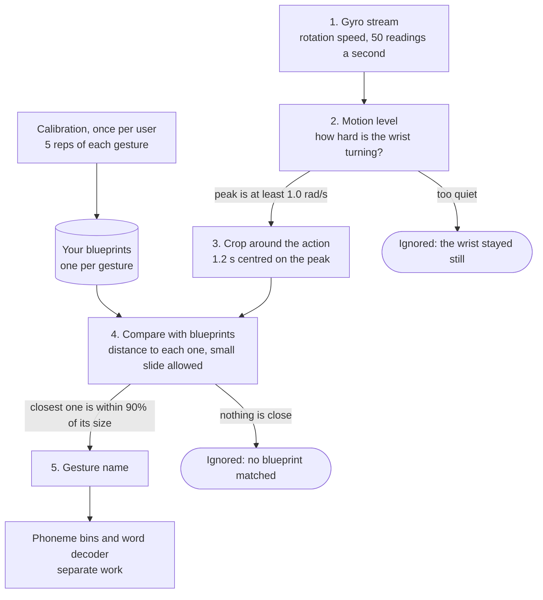
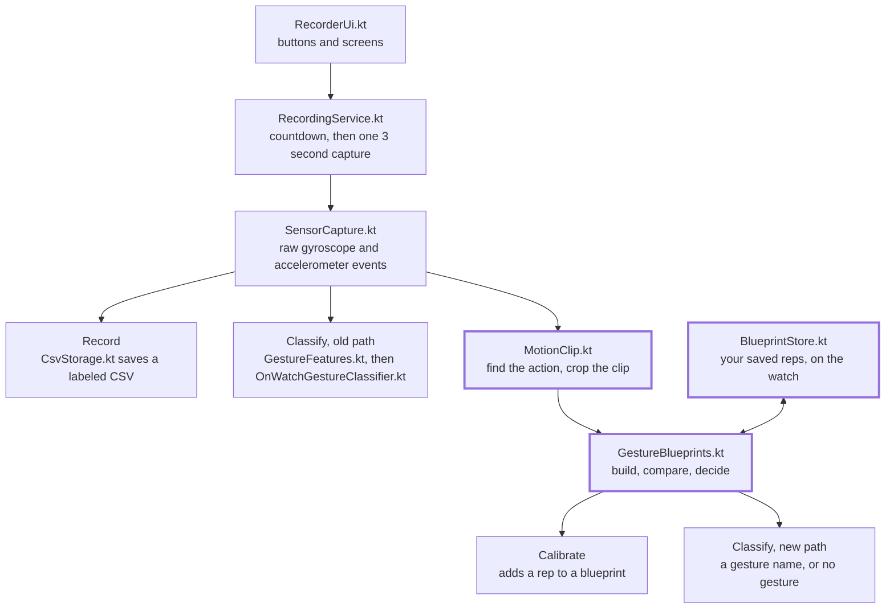

# Tactura gesture recognition v2: implementation plan

Russell Mehta. Written Nov 10, 2026. Last updated Nov 15, 2026.

> **Where the build stands (Nov 11).** Phases 0 and 1 are done. Phase 2 runs on the Galaxy Watch 7: calibration, blueprint Classify and the "no gesture" answer all work. The **Wrong?** correction is not built yet, and nothing from phases 3 to 5 is started. The diagrams and formulas in this file render on GitHub.
>
> **Update (Nov 15).** A scored run five days after calibration gave 54 of 60 with no recalibration of the flicks and twists. The two wrong names were shakes cropped on the wrong stroke. The recipe now cuts one clip per strong stroke (step 3b), confirmed on the watch that evening. Eigengestures (step 7) and a "strong enough" rule (step 6) were built the same night and wait for their watch test. See "Working order" near the end.

## The one-minute version

We are replacing the 500-tree model with personal gesture blueprints that the watch learns from each user in about three minutes.

- **The problem.** The current model learned how the recorder held his arm, not the gestures. On a new person it scored 25 of 51 (49%). It also named a gesture for a motionless arm every single time.
- **The fix.** Each user shows the watch every gesture a few times. The watch saves one blueprint per gesture, then matches each new movement to the closest blueprint.
- **Two rules make it work.** Look only at motion, never at arm angle. Line every movement up in time before comparing.
- **What it scored.** Built from only 3 of Russell's reps per gesture, it got about 96% on his remaining gestures in laptop tests.
- **On the watch.** With Russell's own blueprints the watch named 41 of 50 gestures correctly and gave zero wrong names. The old model got 25 of 51 with 26 wrong names.
- **What stays.** The recording app, the CSV format, the capture timing and every existing file stay. The new pieces sit beside the current classifier until they prove themselves.

These numbers come from two people and one evening of testing. Treat them as a strong signal, not a final result.

## What we found

The current model works exactly as coded, but it learned the wrong thing: the resting arm angle of each recording batch. The full write-up is `claude/classifier-diagnosis-2026-11-10.md`, a doc in the Tactura project on claude.ai. It is not in this repo. The short version is below.

**The watch app itself is fine.** Dhruv's 11/9 fix made Classify see the same input as training. Re-running all 77 of Russell's watch windows through the laptop model gave the same answer 77 of 77 times. The ONNX file matches the joblib file to six decimal places.

**The training data has a hidden shortcut.** All 250 recordings were made by one person on one evening, 50 of one gesture and then 50 of the next. The arm rested at a slightly different angle in each batch. The accelerometer measures gravity, so it records that angle.

| Test on the 250 training recordings | Accuracy |
| --- | --- |
| Shuffled split (looks great, but misleading) | 96% |
| Train on each gesture's first 35, test on its last 15 | 75% |
| Using only the first 0.2 s, before any gesture starts | 80% |
| Using only the last 1 s, after the gesture is over | 85% |

Guessing would score 20%. A model that scores 80% before the gesture begins is reading the arm, not the motion.

**The watch test confirmed it.** Russell wore the Galaxy Watch 7 on his left wrist and ran 51 labeled gestures plus 20 still-arm windows.

| What Russell did | What the watch said |
| --- | --- |
| Flick Up, 10 times | Correct 10 of 10 |
| Flick Down, 10 times | Correct 0 of 10 |
| Twist Right, 10 times | Correct 3 of 10 |
| Twist Left, 11 times | Correct 9 of 11 |
| Shake, 10 times | Correct 3 of 10 |
| Arm tilted, no motion, 10 times | "Flick Down" 10 of 10 |
| Arm flat on desk, no motion, 10 times | A twist every time, twice above 97% confidence |

**Each fix we tried, on Russell's data.**

| Approach | How it was tested | Accuracy |
| --- | --- | --- |
| Current forest | Trained on Dhruv, tested on Russell's 51 | 49% |
| Forest with the accelerometer hidden | Same | 73% |
| Blueprints, compared slot by slot | Russell's first 3 reps, tested on his other 36 | 64% |
| Blueprints, frequency fingerprint | Same | 97% |
| Blueprints, cropped around the action with a small slide | 3 random reps, tested on the rest, averaged over 20 draws | 96%, worst draw 94% |

**People do the gestures differently.** Russell's shake rotates about five times faster than Dhruv's (about 37 against 8 rad/s). His flick down registers on the twist axis. A blueprint built from Russell's shakes matched 0 of 50 of Dhruv's. This is why one shared model struggles and personal blueprints do not.

**The new recipe on the watch (11/10, late evening).** Russell calibrated 5 gestures with 5 reps each in 3 minutes 16 seconds, then ran the same scorecard as before.

| What Russell did | Old model, 7:15 pm | His blueprints, 10:48 pm |
| --- | --- | --- |
| Flick Up | 10 of 10 | 10 of 10 |
| Flick Down | 0 of 10 | 10 of 10 |
| Twist Right | 3 of 10 | 10 of 10 |
| Twist Left | 9 of 11 | 10 of 10 |
| Shake | 3 of 10 | 1 of 10, the other 9 ignored |
| Gestures given a wrong name | 26 | 0 |
| Still arm named as a gesture | 20 of 20 | 1 of 11, a faint twitch, fixed by lowering the limit to 90% |

The blueprints also held across sittings. Applied to the windows recorded three hours earlier, they named 41 of 41 flicks and twists correctly and ignored 20 of 20 still-arm windows. The watch and the laptop gave identical answers on all 69 windows from the evening test.

Shake failed because it is not one motion yet. Russell's shakes ranged from 0.8 to 4 wiggles per second and from 16 to 37 rad/s over the evening. Calibration now checks that each rep can be recognised from the other four, drops the odd one out, and asks for another.

**After pinning shake down (11/10, 11 pm).** Shake was defined as "3 quick wiggles" and recalibrated on its own. In the next round the watch got 26 of 31 right: Shake 7 of 10, Flick Up 5 of 5, Flick Down 4 of 5, Twist Left 5 of 5 and Twist Right 5 of 6. Four real gestures were ignored and one shake was named Twist Left. The wording "3 quick wiggles" is a placeholder until the team agrees on a definition.

## The new idea in plain words

The watch should recognise your gestures the way a bank recognises your signature: by comparing against samples you gave it.

| The bank | Tactura |
| --- | --- |
| You sign a few times when you open the account. | You do each gesture a few times when you first open the app. This is calibration. |
| A new signature is compared with your samples. | A new movement is compared with your saved blueprints. The closest one wins. |
| It does not matter where on the page you sign. | It does not matter whether you start the gesture early or late. The watch lines things up first. |
| The colour of the paper is ignored. | The resting angle of your arm is ignored. Only motion counts. |
| A scribble that matches nothing is rejected. | A movement that matches no blueprint is ignored. So is a still arm. |

**The recipe in four steps**

1. **Look only at motion.** Use the gyroscope (how fast the wrist is rotating). Leave out the accelerometer, because it carries the arm angle.
2. **Find the action and crop around it.** Locate the moment the wrist moves the most. Keep a short clip centred on that moment.
3. **Average a few reps into a blueprint.** One blueprint per gesture, per person.
4. **Pick the closest blueprint, or say nothing.** If no blueprint is close, or the wrist never moved much, the answer is "no gesture".

**Why not just retrain the forest?**

- It needs many varied recordings from many people to stop finding shortcuts. We have four people.
- It has five possible answers and cannot say "nothing happened".
- It is trained on a laptop, converted, and bundled into the app. Blueprints are learned on the wrist.

The forest stays in the app for now so we can compare the two side by side.

## The pipeline

Every movement passes two gates before it gets a name: it must be loud enough, and it must match one of your blueprints.



Read it top to bottom. Calibration happens once and feeds the blueprints. The numbered steps happen for every movement.

1. **Gyro stream.** The watch reads rotation speed 50 times a second. In the button version this is the 3 second window the app already captures. In real-time mode it is a rolling buffer.
2. **Motion level.** One number that says how hard the wrist is turning. A still arm stays near zero, so it stops here and is ignored.
3. **Crop around the action.** Keep 1.2 seconds centred on the loudest moment. Early or late no longer matters.
4. **Compare with blueprints.** Measure how far the clip is from each blueprint, allowing a small slide. If nothing is close, it is ignored.
5. **Gesture name.** The closest blueprint wins. The name then goes to the phoneme bins and the word decoder, which are separate work.

The math for each box is in the next section.

## The math, step by step

Every step is plain arithmetic: add, average, subtract, compare. Each one has a sentence, a formula, and the number we tested with.

**What the watch gives us.** Fifty times a second, the gyroscope reports how fast the wrist is rotating around three axes, in radians per second. One reading is three numbers. A 3 second window is 150 readings.

```math
g_t = \left(g^{x}_t,\; g^{y}_t,\; g^{z}_t\right)
```

### Step 1. Motion level

How hard is the wrist turning right now? Square the three numbers, add them, average over a short stretch, and take the square root. The averaging stops one jittery reading from looking like a gesture.

```math
m_t = \sqrt{\frac{1}{W}\sum_{k=-3}^{3}\lVert g_{t+k}\rVert^{2}}, \qquad W = 7 \text{ readings} = 140 \text{ ms}
```

### Step 2. Find the action

The action is where the motion level peaks. If even the peak is quiet, nothing happened.

```math
t^{*} = \arg\max_t \, m_t, \qquad \text{gesture present only if } m_{t^{*}} \ge \theta, \quad \theta = 1.0 \text{ rad/s}
```

Measured: Russell's still arm never went above 0.44 rad/s. The gentlest real gesture from either person reached 1.68. The threshold sits in the gap.

### Step 3. Crop

Keep 30 readings before the peak and 30 after. That is 1.2 seconds on three axes, so every clip is a list of 180 numbers with the big swing in the same place.

```math
x = \left(g_{t^{*}-30},\; \dots,\; g_{t^{*}+29}\right) \in \mathbb{R}^{180}
```


The grey line is the raw rotation. The blue line is the motion level from step 1, and the dot is its peak from step 2. The shaded band is the clip from step 3, and the dashed red line is the motion threshold. Had Russell started 300 ms later, the band would simply sit 300 ms further right, and the clip inside it would look the same. The picture is drawn from the real recording by `python ML\plot_find_the_action.py`.

### Step 3b. One clip per strong stroke

Some gestures have two strokes of about the same strength. A shake is a left stroke and then a right stroke. "The loudest moment" is then a coin flip between them, and the clip lands about a third of a second apart from one rep to the next. The slide in step 5 can only correct a tenth of a second.

So the recipe does not guess. A stroke counts as strong when its motion level reaches 60% of the peak and it is the highest point within 160 ms on either side. Every strong stroke gets its own 1.2 second clip, up to three.

```math
\text{strong strokes} = \left\{\, t \;:\; m_t \ge 0.6\, m_{t^{*}} \ \text{ and } \ m_t = \max_{|k-t|\le 8} m_k \,\right\}
```

A twist or a flick has one dominant stroke, so it usually gives one clip that matters and nothing changes. When there are several clips, step 6 compares every clip with every blueprint and keeps the single best fit. During calibration, the clip that best fits the earlier reps of the same gesture is the one saved, so all reps of a two-stroke gesture end up centred on the same stroke.

Measured on the 11/15 run with the blueprints already on the watch: both misnamed shakes became Shake, at 75% and 71% match, and nothing else changed (56 of 60, no wrong names).

### Step 4. Blueprint

A blueprint is the average of a few clips of the same gesture, number by number. It is your typical version of that gesture.

```math
\mu = \frac{1}{n}\sum_{i=1}^{n} x_i
```

### Step 5. Distance, with a small slide

To compare a clip with a blueprint, subtract them number by number, square, average, and take the square root. The result is in rad/s and reads as "on average these two disagree by this much". Because the peak finder can be off by a hair, we try sliding the clip up to 100 ms each way and keep the best fit.

```math
d(x,\mu) = \min_{-5 \le s \le 5}\; \sqrt{\frac{1}{180}\sum_{j=1}^{180}\left(x^{(s)}_j-\mu_j\right)^{2}}
```

Here the clip with a superscript s means the clip shifted by s readings. Measured: a gesture sits a median 0.6 rad/s from its own blueprint and 2.7 rad/s from the nearest wrong one.

### Step 6. Decide

The closest blueprint wins, but only if it is close enough. Otherwise the watch says nothing.

```math
\hat{g} = \arg\min_{g}\; d(x,\mu_g), \qquad \text{answer } \hat{g} \text{ only if } d(x,\mu_{\hat{g}}) \le \tau_{\hat{g}}
```

The limit is a percentage of the gesture's own size. A clip must miss its closest blueprint by no more than 90% of that blueprint's size, where size is the root mean square of the blueprint. A fixed limit in rad/s was tried first and failed: 1 rad/s is a tiny miss for a twist, but it is the whole gap between Flick Up and Flick Down. With the percentage rule, wrong names fell from 4% to 0%, 12% of real gestures were ignored, and a gesture with no blueprint was ignored every time. The limit sits below 100% on purpose: a clip of no motion is exactly 100% away from every blueprint, so at 100% a faint twitch once passed as a Flick Up on the watch.

Since 11/15 there is a second rule, "strong enough". Eigengestures (step 7) forgive part of the gap between a clip and a blueprint, and for a small gesture that can include most of the gap to no motion at all. So a clip that is close enough only thanks to that forgiveness must also be at least 60% of the winning blueprint's size. A clip that is already close enough the plain way (step 5) is accepted whatever its strength, so an honest soft rep is not thrown out.

```math
\text{answer } \hat{g} \text{ only if } \ d_{\text{eig}} \le 0.9\,s \ \text{ and } \ \left(\, d \le 0.9\,s \ \text{ or } \ \text{size}(x) \ge 0.6\,s \,\right), \qquad s = \text{size}(\mu_{\hat{g}})
```

Here d is the plain distance from step 5 and the other one is the forgiving distance from step 7, both measured to the winning blueprint.

### Step 7. Eigengestures (built 11/15)

The average says "here is your typical flick". Eigengestures add "and here are the ways you usually differ from it". A person's reps are not scattered evenly around their average. They are stretched in a few directions, and a rep that sits far out along one of those directions is still a normal rep for that person.

**Finding the directions.** Take the reps after lining up and subtract the blueprint from each one. The directions are the top eigenvectors of the covariance of those differences.

```math
e_i = x_i-\mu, \qquad C = \frac{1}{n}\sum_{i=1}^{n} e_i\,e_i^{\top}, \qquad C\,v_k = \lambda_k v_k, \qquad \sigma_k = \sqrt{\lambda_k}
```

Each direction is a list of 180 numbers with length 1. The spread says how far the reps typically sit along it. We keep the top 2. With n reps there are at most n minus 1 directions, so the code finds them from the small n by n table of dot products between reps, using a simple method (Jacobi rotations) that is written the same way in Python and Kotlin.

**Comparing.** Line the clip up with the blueprint the plain way (step 5). Then measure how much of the leftover follows each direction, remove that part, and measure what remains. The removal is capped at 1.5 times the spread, so a movement far outside the user's habits still counts as different.

```math
c_k = v_k^{\top}(x-\mu), \qquad r = (x-\mu) - \sum_{k=1}^{2}\operatorname{clip}\left(c_k,\,\pm 1.5\,\sigma_k\right)v_k, \qquad d_{\text{eig}}(x) = \frac{\lVert r\rVert}{\sqrt{180}}
```

Step 6 now uses this distance for both picking and judging.

**What it found.** In Russell's 11/15 afternoon Flick Up, the first direction holds 62% of the variation between reps, and 86% of it is on the twist axis. It is neither "stronger or weaker" nor "earlier or later". The math found that the main way his flick varies is how much forearm twist leaks into it. One real flick that missed the blueprint by 74% of its size missed by 48% once the two directions were forgiven.

It needs at least 3 reps to give any direction and 5 to be meaningful. Calibration already asks for 5.

### Step 8. Learning over time

Every gesture the user confirms or corrects is one more rep. Folding it into the average takes one line.

```math
\mu \leftarrow \mu + \frac{x-\mu}{n+1}, \qquad n \leftarrow n+1
```

Later, a new user can start from a shared team blueprint instead of from nothing. The shared blueprint counts as a fixed number of reps, and each real rep pulls the result toward the user. This is the prior-then-posterior idea.

```math
\mu_{\text{user}} = \frac{\kappa\,\mu_0 + \sum_{i=1}^{n} x_i}{\kappa + n}
```

### In reserve: the frequency fingerprint

Describing a clip by how much of each wiggle speed it contains also ignores timing, because a delay changes only the phase of the Fourier transform and not its size.

```math
x(t-\tau)\;\longleftrightarrow\; e^{-i 2\pi f \tau}\,X(f) \quad\Rightarrow\quad \lvert X(f)\rvert \text{ is unchanged by a delay}
```

It scored 97% in the same test. Its weakness is that a signal and its mirror image have the same fingerprint, so in theory it cannot tell Twist Left from Twist Right. Cropping keeps direction, so cropping is the main path and frequency stays available as a second opinion.

### Settings we tested with

| Setting | Value | Why |
| --- | --- | --- |
| Sensor rate | 50 readings a second | Measured on both watches |
| Motion smoothing | 7 readings (140 ms) | Middle of the range we tried (60 to 300 ms) |
| Motion threshold | 1.0 rad/s | Between the loudest still arm (0.44) and the quietest gesture (1.68) |
| Clip length | 60 readings (1.2 s) | Results held from 0.6 s to 2.0 s |
| Slide when comparing | 5 readings each way (100 ms) | Gave 96 to 97% with a worst draw of 94% across the smoothing settings tried |
| Strong stroke | At least 60% of the peak, highest within 8 readings (160 ms) each way, at most 3 per window | First guess, set on 11/15. Not tuned yet |
| Reps per gesture | 5, with 3 as the minimum | 3 is enough for the average, 5 allows eigengestures |
| Eigen directions | 2 | Russell's pick on 11/15 after a sweep of 1 to 4. The first helps most inside one sitting, the second on a new sitting. More than 2 kept adding a few points but accepted more odd movements |
| Eigen cap | 1.5 times the spread seen in calibration | First set to 2, then tightened by Russell on 11/15 after the first real random-movement test. Caps from 1.5 to none changed accuracy by at most 2 points, and a tighter cap leaked less |
| "Strong enough" limit | At least 60% of the blueprint's own size, checked only for clips that needed eigengesture forgiveness to be close enough | Added 11/15 as a guard for eigengestures. Applied to every clip it threw out 4 honest soft Flick Downs in 10, so Russell narrowed it the same night |
| "Close enough" limit | Within 90% of the blueprint's own size | Russell's rule. Laptop: 88% correct, 12% ignored, 0% misnamed. Watch: 41 of 41 flicks and twists in each of two sittings |
| Weight of the shared blueprint | Open | Needs data from more people |

## How it fits the current codebase

Nothing in the recording or classifying code is rewritten. Three new Kotlin files sit beside the current classifier and read the same captured events, so the old path keeps working the whole time.



The capture at the top is shared. Record, today's Classify and the new blueprint path all branch off after the same 3 second window, so they always see identical data. The three new files have the thick border. All names are Kotlin files under `wear/src/main/kotlin/com/gesturedatarecorder/`.

**Files that stay exactly as they are**

| File | Why it is left alone |
| --- | --- |
| `SensorCapture.kt` | Holds the raw events and builds the CSV text. The CSV format must not change. |
| `GestureFeatures.kt` and `GestureFeaturesParityTest.kt` | The forest's 192 numbers and the test that guards them. Still needed while the forest stays. |
| `OnWatchGestureClassifier.kt` | The forest and its loader. Kept as a comparison until phase 2 passes. |
| `RecordingRepository.kt`, `MainActivity.kt` | App state and permissions. They already do what we need. |
| `ML/train_gesture_classifier.py`, `ML/export_gesture_model.py` | The forest's training and export. Untouched. |
| `recordings/`, `simulator/` | Existing data and the simulator. Untouched. |

**New files**

| File | What it does | Phase | Status |
| --- | --- | --- | --- |
| `ML/blueprint_reference.py` | The recipe in Python: motion level, crop, blueprint, distance, decide. The source of truth. | 0 | Built |
| `ML/evaluate_blueprints.py` | Scores the recipe on the recordings with honest splits. | 0 | Built |
| `ML/dump_reference_clips.py`, `ML/dump_reference_blueprints.py` | Write reference clips, blueprints and decisions for the Kotlin parity tests. | 1 | Built |
| `MotionClip.kt` | Kotlin port of steps 1 to 3. Takes the captured events, returns a 180-number clip, or nothing if the arm was quiet. No Android code inside, so it can be unit tested on a laptop. | 1 | Built |
| `GestureBlueprints.kt` | Kotlin port of steps 4 to 6 and 8. Builds blueprints, measures distance, picks a gesture or "no gesture", updates an average, and finds the odd rep out during calibration. | 1 | Built |
| `MotionClipParityTest.kt`, `GestureBlueprintsParityTest.kt` | Check the Kotlin numbers against the Python numbers on real recordings. | 1 | Built |
| `BlueprintStore.kt` | Saves and loads the user's calibration reps as a small JSON file in app-private storage, and builds the blueprints from them. | 2 | Built |
| `ui/TacturaTheme.kt` | The Tactura look for the watch screens: colors, the Doto and Space Mono fonts, cut-corner buttons. | 2 | Built |
| `ML/plot_find_the_action.py` | Draws the "find the action" chart in this doc from a real recording. | Docs | Built |
| `MotionGate.kt` | The rolling buffer and quiet-loud-quiet logic for real-time mode. | 4 | Planned |

**Files that get small additions**

| File | What is added | What is not touched |
| --- | --- | --- |
| `RecordingModels.kt` | A third session mode, `CALIBRATE`, next to `RECORD` and `CLASSIFY`. Calibration progress in `RecordingStatus`. | The `Gesture` enum and its labels |
| `RecordingService.kt` | One new branch after the capture for `CALIBRATE`. In the `CLASSIFY` branch, the blueprint answer is used when blueprints exist, and the forest answer is logged beside it. | The countdown, the 3 second capture, the sensor setup, `PREPARE_SECONDS` and `CAPTURE_MS` |
| `CsvStorage.kt` | A `GestureCalibration` folder constant, and file names for calibration reps and "no gesture" windows. The context file comes in phase 3. | The existing folders, numbering and save logic |
| `RecorderUi.kt` | A **Calibrate** button on the home screen, a "no gesture" result, and redo and reset for calibration. The screens were also restyled to the Tactura look. The **Wrong?** control is still to come. | What each button does, and the countdown and capture flow, which calibration reuses |
| `AndroidManifest.xml`, `strings.xml` | The app is now named Tactura and has its own icon. | The package name, so installs still update in place |
| `README.md` | A Calibrate section and the new folder. | Everything else |

**The rule we keep.** The repo already works this way for the forest's features: Python is the source of truth, Kotlin is a line-by-line port, and a unit test fails if they ever disagree. The blueprint code follows the same pattern, so a change on one side cannot silently drift from the other.

**One housekeeping item before anyone else builds.** `local.properties` is committed and points at Dhruv's Android SDK folder. Each person needs their own path there, and the file should come out of version control.

## Calibration on the watch

Calibration is a guided run of Record: the watch names a gesture, you do it, and after a few reps it builds your blueprint. It reuses the capture the app already has.

**What the user does**

1. Tap **Calibrate** on the home screen.
2. The watch shows the first gesture name, for example "Twist Left, rep 1 of 5".
3. Same three short buzzes, then the strong buzz. Do the gesture once.
4. The watch checks the rep. If the wrist never moved enough, it says "Didn't catch that" and repeats the rep.
5. If a rep looks very different from the earlier ones, it asks for one more instead of averaging in a mistake. A rep with two equally strong strokes is first lined up with the earlier reps (step 3b), so it is no longer dropped for that reason.
6. After the last rep of the last gesture, the watch builds and saves the blueprints. Classify now uses them.

With 5 gestures, 5 reps each and about 7 seconds per rep, calibration takes about 3 minutes. With 3 reps it takes under 2.

While calibrating, the countdown screen shows how to do the gesture once the team has agreed a definition. Today only Shake has one: "3 quick wiggles".

**What gets saved**

| What | Where | Why |
| --- | --- | --- |
| Every calibration rep as a raw CSV, in today's exact format, labeled with the gesture you were asked to do | `/sdcard/Download/GestureCalibration/` | Raw data with a true label, for the future shared dataset |
| The calibration clips for each gesture | App-private storage on the watch, one small JSON file | Loaded each time the app starts. The blueprints are rebuilt from them. |

**Fixing a wrong answer (not built yet)**

The Classify result screen will get one extra control: **Wrong?** Tapping it shows the gesture list. Picking the right gesture does two things.

- It saves that window with the true label and a note that the user corrected it.
- It folds the window into the right blueprint (step 8 of the math).

This is the simple, explicit version of learning over time. A quieter version comes later: once the word decoder exists, undoing a gesture or committing a word tells the watch the same thing without a prompt.

**Redo and reset.** The user can recalibrate one gesture or all of them. Recalibrating replaces the blueprint and keeps the old raw CSVs.

## Real-time mode

Real-time mode removes the button and the countdown: the watch listens all the time and reacts when it sees a burst of motion. It comes after the button version works. A first version was built on 11/15: see "Listen mode, Nov 15" near the end. The notes below are the plan it started from.

**How it works**

1. **Sensors stay on.** The watch keeps only the last 2 seconds in memory, like a dashcam that keeps overwriting itself.
2. **It tracks the motion level** from step 1 of the math on every new reading.
3. **Quiet turns loud.** When the level crosses the threshold, a gesture has started.
4. **Loud turns quiet again.** When the level stays below the threshold for about 200 ms, the gesture is over.
5. **Crop, compare, decide.** The watch crops 1.2 s around the peak and runs steps 3 to 6 of the math.
6. **Short pause.** It ignores motion for a moment so one gesture is not counted twice.

The same "find the action" step that lines gestures up is also the trigger. Nothing new has to be invented, only run continuously.

**Cost.** Comparing one clip against five blueprints with eleven slide positions is about ten thousand subtractions. That is far less work than the forest the watch runs today.

**Real problems to solve**

| Problem | First idea |
| --- | --- |
| Everyday motion is also loud (walking, reaching for a cup) | The "close enough" limit in step 6 rejects movements that match no blueprint. It needs testing with real daily motion. |
| Gestures back to back | Require a short quiet gap between gestures, and tell users so. |
| Battery, with sensors always on | Measure it. If it is bad, add a "listening" toggle or a wake gesture. |
| Tuning the trigger by feel | Dhruv's planned live streaming to a laptop shows the motion level on a big screen. It is a tuning tool and is not needed once tuned. |

**Where it goes in the code.** A new session mode in `RecordingService` keeps the sensor listeners registered and feeds each reading to a small new class, `MotionGate`, which holds the rolling buffer and the quiet-loud-quiet logic. Everything after the gate is the same code as the button version.

## The data we keep

Every calibration rep and every classified window is saved as raw sensor data with context, so the team can pool it later and train a stronger shared model. Using the product builds the dataset. The raw CSVs are saved today. The context file is phase 3 and is not built yet.

**Rule 1: always keep the raw recording.** Blueprints and other patterns are today's best guess. We only caught the arm-angle problem because the raw recordings were still there to re-test. Derived patterns can be saved too, but never instead of raw.

**Rule 2: the CSV format does not change.** The header and columns stay exactly as they are, so the training script, the plotting tool and all 250 existing recordings keep working. Context goes in a small companion file, not in new CSV columns.

**The context saved with each recording**

| Field | Example | Why it matters |
| --- | --- | --- |
| Recording file | `0012_twist_left_20261112_193000.csv` | Links the context to the raw data |
| User | `u07` (an anonymous code, never a name) | Lets us test on people the model has not seen |
| Wrist | left | Mirrors the motion |
| Watch model | Galaxy Watch 7 | Different sensors, different mounting |
| Session | `2026-11-12-a` | Lets us test across days, which a shuffled split hides |
| Intended gesture | TWIST\_LEFT | The true label |
| How we know | calibration prompt, user confirmed, or user corrected | A corrected mistake is the most useful example there is |
| What the watch predicted | TWIST\_RIGHT, distance 1.9 | Shows where the model is weak |
| App version | 1.1 | Capture details can change between versions |

**Where files go on the watch**

| Folder | Contents | Status |
| --- | --- | --- |
| `/sdcard/Download/GestureDataRecorder/` | Record mode training CSVs | Exists today, unchanged |
| `/sdcard/Download/GestureClassify/` | Every classified window | Exists today, gains the context file |
| `/sdcard/Download/GestureCalibration/` | Calibration reps | New |

Each folder gets one context file, `context.jsonl`, with one line per recording. Pulling a folder with `adb pull` brings both.

**Before collecting from people outside the team.** Ask for consent in the app, store only the anonymous code, and ask Prof. Nishida whether publishing with this data needs ethics approval. It is cheap to settle now and painful to fix later.

## Build phases and how we test each one

We build in six small phases, and each one has a test that must pass before the next starts. Phases 0 to 2 are the December demo. Phases 3 to 5 are what comes after.

| Phase | What gets built | It is done when | Status (Nov 11) |
| --- | --- | --- | --- |
| 0. Prove it on the laptop | `ML/blueprint_reference.py` (the recipe in Python, the source of truth) and `ML/evaluate_blueprints.py` (the scoring) | Anyone on the team can run one command and get the numbers in this doc from the recordings in the repo | Done |
| 1. Port to the watch code | `MotionClip.kt`, `GestureBlueprints.kt` and a parity test | The Kotlin code gives the same clips and distances as the Python on real recordings, checked by a unit test | Done. The parity tests pass. |
| 2. Calibrate and classify on the watch | Calibrate mode, blueprint-based Classify, the "no gesture" answer, the **Wrong?** correction | A teammate who is not in any training data calibrates, then passes the scorecard below | Running on the watch. **Wrong?** is not built. Russell scored 41 of 50 right after calibrating, below the 90% target, and no teammate has tried it yet. |
| 3. Learn and log | Corrections update blueprints. Context files are written for every recording. | A corrected gesture is recognised next time, and a pulled folder has a context line per CSV | Not started |
| 4. Real-time listening | `MotionGate` and the always-listening mode | Ten gestures in a row with no button, plus one minute of ordinary arm movement with at most one false gesture | Not started |
| 5. Upgrades | Eigengestures, a shared starting blueprint, the frequency second opinion | Each one beats the plain average on data from at least three people, or it is dropped | Not started |

**The phase 2 scorecard**

| Check | Target |
| --- | --- |
| 10 reps of each calibrated gesture, done right after calibration | At least 90% correct |
| The same 10 reps on a different day, without recalibrating | At least 85% correct |
| Still arm in three poses (flat, tilted, hanging), 10 windows | 0 gestures named |
| Arm moved between poses without a gesture, 10 windows | At most 1 gesture named |

The targets are proposals for the team to set. The watch test on 11/10 took about 25 minutes for 77 windows, so this scorecard fits in one sitting.

**Testing rules, learned the hard way**

- **Never trust a shuffled split of one sitting.** It scored 96% on a model that scored 49% on a real person. Test on a different day or a different person.
- **Always include "nothing happened" windows.** A model that cannot say "no gesture" looks fine until someone holds still.
- **Report every gesture separately.** An average hid the fact that Flick Down scored 0 of 10.
- **Write down the truth as you go.** The watch only saves what it guessed. After phase 3 the context file does this for us.
- **One knob at a time.** One early result here swung from 80% to 100% with a single smoothing setting. A number that depends on one lucky setting is not a result.

## Working order (Nov 15)

The demo target is solid personal gesture recognition with the math front and center. The order below makes the current five gestures provably reliable before anything new is added. Where it disagrees with the phase table above, this order wins. It is a working proposal and the team can change it.

**Done on 11/15**

| Work | Result |
| --- | --- |
| Scorecard on five-day-old blueprints | 54 of 60. Twists survive five days. Details below |
| Alignment: one clip per strong stroke | Shakes no longer cropped on the wrong stroke. Confirmed on the watch |
| Eigengestures (2 directions, cap 1.5) and the "strong enough" rule | The day's 96 scored windows went from 89 to 95 right. 30 of 30 random movements ignored |

**Roadmap from here**

| Order | Work | Why it matters | Needs |
| --- | --- | --- | --- |
| 1 | Clean exam on another day: no recalibration, 10 of each gesture, 10 random movements | Everything on 11/15 was tuned and tested the same evening. This is the proof that flicks and eigengestures hold on older blueprints | Russell, the watch, 15 minutes |
| 2 | Make the 11/15 evidence reproducible: label files for the pulled rounds, the comparison scripts in the repo | The day's numbers come from untracked folders and scratch scripts. A teammate cannot rerun them yet | Laptop only |
| 3 | A teammate calibrates and runs the scorecard | Every setting is tuned on one wrist plus Dhruv's October recordings. This is the exit test of phase 2 | A teammate, the watch |
| 4 | Remember sittings and the **Wrong?** correction (both built 11/15, Wrong? not yet run on the watch) | Flicks change from sitting to sitting. One blueprint per sitting plus eigengestures scored 86% on a new sitting in the laptop test, against 66% for one blueprint. Includes the context file of phase 3 | Design decisions from Russell, then code |
| 5 | Gesture definitions | Flick is small and variable, Shake and Twist Left are close relatives, Double Tap has no recordings. Written definitions and on-watch hints | Team decision |
| 6 | Real-time listening (first version built 11/15, not yet run on the watch) | No button. The biggest change in how the demo feels. Needs a false-alarm budget and more random-movement data | Code, the watch |
| 7 | The write-up and demo video | The math story for graduate applications: the diagnosis, blueprints, the alignment fix, what eigengestures found | Russell |
| 8 | Repo cleanup and merge | About 1000 tracked build files, `local.properties`, merging `blueprints`. Needs a heads-up to Dhruv | Team |
| Parked | Phoneme bins, word decoder and speech on the watch. Chords with the accelerometer. Pooling data across users, with the consent question for Prof. Nishida | After the recognition demo | |

### Scorecard, Nov 15 (step 1, done)

Russell, Galaxy Watch 7, left wrist. Flick Up, Flick Down, Twist Left and Twist Right used the 11/10 blueprints with no recalibration, five days later. Shake was recalibrated a minute before the run. Truth comes from the order he did the gestures in. No "nothing" windows were run this time. All 60 windows gave the same answer on the laptop as on the watch.

| Gesture | Correct | Ignored | Misnamed | Match shown on the watch |
| --- | --- | --- | --- | --- |
| Twist Left | 12 of 12 | 0 | 0 | 59 to 83% |
| Twist Right | 12 of 12 | 0 | 0 | 50 to 81% |
| Flick Up | 14 of 14 | 0 | 0 | 11 to 55% |
| Flick Down | 8 of 12 | 4 | 0 | 11 to 39% |
| Shake | 8 of 10 | 0 | 2, both called Twist Left | 58 to 81% |
| **Total** | **54 of 60 (90%)** | **4** | **2** | |

**What the data showed**

- **Twists survive five days.** Same match range as on 11/10.
- **The two misnamed shakes were good shakes, cropped in the wrong place.** Russell's shake is a left stroke then a right stroke, about equally loud. "Find the action" centres the clip on the louder one. Eight times that was the right stroke, as in calibration. Twice it was the left stroke, which moved the clip by about 340 ms. The slide in step 5 only corrects 100 ms. A shake cropped around its left stroke looks like a Twist Left. Allowed to slide further, both clips match the Shake blueprint, missing it by 50% and 38% of its size.
- **Flicks sit at the limit.** Today's flicks were about 25 to 30% smaller than on 11/10. Today's Flick Down was mostly on the y axis (78%), where the 11/10 calibration was mostly on x (60%). But a blueprint built from the first five of today's reps did not clearly do better on the rest: Flick Down 4 of 7 against 3 of 7 with the old one, Flick Up 7 of 9 against 9 of 9. Today's flicks miss a blueprint built from each other by a median 55% (up) and 69% (down) of its size. So the main issue is variation between reps of a small gesture, more than a stale calibration. This is one split on few windows, so treat it as a pointer.
- **Arm tremor is measurable but small.** The resting motion level was 0.06 rad/s, against 0.04 on 11/10. A flick is about 0.8.

The pulled files are in `classify_logs_v3/` (files 0117 to 0176) and `calibration_logs_v2/`.

### Alignment fix, Nov 15 (step 2, part A)

The scorecard left two separate problems. A: a clip can be centred on the wrong stroke. B: flicks are barely bigger than the normal variation between reps. Part A is fixed in the code and waits for a watch test. Part B is next.

Three ways of centring the clip were compared. Each number uses 5 random reps per gesture as blueprints and tests on the rest, repeated 12 times, with the 90% limit on.

| Method | Russell, 11/15 | Russell, 11/10 | Dhruv's recordings |
| --- | --- | --- | --- |
| Loudest moment (the old way) | 92% correct, 3% misnamed | 89% | 84% |
| Balance point of the action | 96%, 0% misnamed | 79% | 91% |
| One clip per strong stroke (chosen) | 96%, 0.5% misnamed | 89% | 91% |

- **The balance point was tried first and rejected.** It is the average time of the loud readings, weighted by loudness. It fixed the shake but dropped Russell's 11/10 Flick Down from 72% to 22%. A flick is a stroke plus a rebound, and the rebound's strength changes from rep to rep, which drags the balance point by up to 180 ms. A second movement later in the window (the arm resettling) drags it into the quiet gap between the two.
- **One clip per strong stroke was never worse than the old way** on the three data sets, and matched the balance point's gains.
- **The repo's own evaluation agrees.** `python ML\evaluate_blueprints.py` before and after: Dhruv with 5 reps went from 83% to 88% correct with the limit on, Russell's 11/10 set went from 91% to 90%, and the first-5-then-45-later test went from 214 to 213 of 225.
- **What it does not fix.** Russell's Shake (left, right, back to centre) and Twist Left (left, then back) are close relatives on the same axis. Once shakes are lined up properly, hiding either blueprint makes the watch call most of that gesture by the other's name. With both blueprints present they were told apart every time in the 11/15 run. A shake that starts to the right, or has more wiggles, would sit further from a twist. That is a gesture design decision for the team.
- **One thing to watch.** Trying more clips gives every blueprint more chances to fit, including the wrong one. On Russell's 11/10 shake, which had no definition yet, "closest wins" with no limit went from 81% to 72%.

**On the watch, 11/15 evening.** The build with one clip per strong stroke compiled, all 18 parity tests passed, and the watch gave the same answer as the laptop on 16 of 16 windows. After recalibrating Shake at his natural pace, Russell did 15 shakes and one Twist Left: 16 of 16 correct, with the shakes at 67 to 88% match. The old recipe would have called 6 of those 15 shakes Twist Left.

**Tempo matters.** An earlier batch of 20 shakes the same evening, on the old build and a slower calibration, scored 17 of 20. The gap between the two strokes was 360 ms in that calibration and 230 to 350 ms in the test, and the match fell from about 55% to about 15% as the gap shrank (correlation 0.91). The comparison can slide a clip in time but it cannot stretch it. Calibrating at the pace the gesture is really done at fixed it for now.

**Not built yet: one ruler.** The winner is picked by raw distance in rad/s but judged by percent of size. A fast shake once missed Shake by 73% of its size and Twist Left by 87%, yet Twist Left won because it is the smaller gesture (3.35 against 3.39 rad/s). Picking the winner by percent too gave 19 of 20 on that batch and helped on Dhruv's data, but turned some ignored windows into wrong names on Russell's 11/10 set (0% to 3.5%). It was then tested on flicks and dropped, see the next section.

The comparison of the three methods was run from a scratch script and is not in the repo. The chosen method is in `ML/blueprint_reference.py`, so the evaluation script reproduces its numbers.

### Flick variation, Nov 15 (step 2, part B: measured, not fixed yet)

Flick Up and Flick Down had to be recalibrated twice on 11/15 because they slid to "no gesture" within hours, while the twists ran on five-day-old blueprints. The recordings show why: Russell does not do the same flick from one sitting to the next. How much forearm roll sneaks into it changes a lot.

| Sitting | Flick Up: share of motion on the twist axis, size | Flick Down: share on the twist axis, size |
| --- | --- | --- |
| 11/10 evening test | 50%, 0.94 rad/s | 75%, 0.52 rad/s |
| 11/10 calibration | 33%, 0.99 | 60%, 1.12 |
| 11/10 test after calibrating | 51%, 0.90 | 73%, 0.74 |
| 11/15 afternoon test | 32%, 0.65 | 35%, 0.74 |
| 11/15 recalibration, 5:46 PM | not redone | 32%, 0.67 |
| 11/15 recalibration, 6:47 PM | 8%, 0.82 | 43%, 1.14 |

The blueprints of the same flick from two sittings sit 33 to 160% of their size apart. The limit is 90%, and normal variation inside one sitting already uses 50 to 65%.

**The test.** Each of the 71 flick windows was judged by blueprints that had never seen its sitting, with the twists and Shake present as usual.

| What the watch knows about a flick | Correct | Ignored | Misnamed |
| --- | --- | --- | --- |
| One blueprint from the most recent earlier sitting (what the app does today) | 47 (66%) | 24 | 0 |
| The same, plus eigengestures (step 7) | 53 (75%) | 18 | 0 |
| One blueprint per earlier sitting | 51 (72%) | 20 | 0 |
| One blueprint per earlier sitting, plus eigengestures | 61 (86%) | 10 | 0 |

For comparison, a flick tested inside the sitting it was calibrated in scores 83%.

- **Eigengestures help.** Russell's idea from 11/10. With 5 reps and 2 directions it recovered 6 of the 24 ignored flicks and named nothing wrong. Inside one sitting it took flicks from 83% to 92%.
- **Remembering earlier sittings helps more when the two are combined.** Keeping one blueprint per sitting, instead of replacing the old one, is the "keeps learning while worn" idea in its simplest form.
- **One ruler was dropped.** Picking the winner by percent of size turned about one flick in eight into a wrong name. A weak flick is roughly 85% away from a big twist on the same axis, which passes the limit. Picking by raw distance lets the small flick blueprint win first and then fail its own limit, so the window is ignored instead. The two rulers protect small gestures.
- **Comparing shape only was dropped.** Letting the strength float between half and double scored 42% across days with many wrong names.
- **Safety check.** With every flick blueprint from all six sittings loaded, 40 of 40 twists and shakes from 11/15 were still right, 20 of 20 still-arm windows were ignored, and no twist or shake was taken for a flick when its own blueprint was hidden.
- **What is missing.** There are no recordings of ordinary arm movement. Eigengestures and extra blueprints both make matching more forgiving, and without those recordings we cannot measure false alarms. Record ten windows of random movement at the next sitting.

The table above used 2 directions and a cap of 3 times the spread. These tests were run from scratch scripts and are not in the repo.

### Eigengestures built, Nov 15 (step 2, part B)

**Choosing the settings.** Russell asked for a sweep before deciding. Cap fixed at 2 times the spread:

| Directions | Flicks in a new sitting | Flicks in the same sitting | All 96 scored windows of 11/15 | Dhruv's recordings | Odd movements accepted, of 96 |
| --- | --- | --- | --- | --- | --- |
| 0 (before) | 66% | 83% | 93% | 84% | 11 |
| 1 | 69% | 97% | 98% | 87% | 18 |
| 2 (chosen) | 75% | 97% | 99% | 88% | 19 |
| 3 | 76% | 97% | 99% | 90% | 24 |
| 4 | 79% | 97% | 100% | 91% | 25 |

"Odd movements" are the real windows with two sensor axes swapped, which gives movements no gesture uses. It is a rough stand-in for random arm movement. He chose 2 directions and a cap of 2, the cautious end, to be revisited once real random movement is recorded.

**A hole found while building, and the guard for it.** A clip of no motion used to be exactly 100% away from every blueprint, which is why the limit sits at 90%. With eigengestures that is no longer true for small gestures. Part of the gap between "nothing" and a flick lies along the flick's own directions of variation, so it gets forgiven: a clip of no motion came out only 65 to 79% away from Russell's Flick Up. A faint twitch could then pass as a flick.

The guard is a second rule next to "close enough": the clip's own size must be at least 50% of the blueprint's size. To test it, every real window was shrunk to a faint copy and run through the recipe, with the motion threshold applied.

| | Faint copies that still got a name, summed over 10, 15, 20, 30 and 40% strength (of 480) | Accuracy on the 96 windows |
| --- | --- | --- |
| Before eigengestures | 132 | 89 right, 6 ignored, 1 misnamed |
| Eigengestures alone | 222 | 95, 0, 1 |
| Eigengestures plus "strong enough" at 50% (built) | 125 | 95, 0, 1 |
| Eigengestures plus "strong enough" at 60% | 86 | 95, 0, 1, and one flick fewer in the new-sitting test |

So the guard brings faint-movement behaviour back to where it was, at no cost in accuracy. Two other options were tried. Forgiving shape only and never strength kept "nothing" at exactly 100% but gave up about half of the gain on flicks. A floor of 60% leaks less and costs one flick in 71. The value is one setting, `MIN_STRENGTH`.

Many of the faint copies that still get a name are faint twists that resemble Russell's Flick Down, which he sometimes does with a lot of forearm roll. That is the gesture set, not the math.

**The repo's evaluation, before and after.** `python ML\evaluate_blueprints.py`: Russell's 11/10 set with 5 reps went from 90% to 95% correct with the limits on, Dhruv from 88% to 91%, the first-5-then-45-later test from 213 to 215 of 225, and the hidden-blueprint test still ignores every window.

**On the watch's own blueprints.** Replaying the 96 scored windows of 11/15 against the reps stored on the watch: 95 right, none ignored, 1 misnamed (a fast shake from before the Shake recalibration). The four ignored Flick Downs of the afternoon all come back. No recalibration is needed, because the watch stores the reps and rebuilds blueprints from them.

**On the watch, 11/15 at 7:20 PM (cap 2, strong enough 50%).** The build compiled, all 20 parity tests passed, and the watch matched the laptop on 50 of 50 windows. Russell did 20 movements that should be ignored and 30 real gestures, with no recalibration.

| Part | Result |
| --- | --- |
| 10 random movements (reach, scratch hair, wave, lower arm, punch, raise hand, stretch) | 9 ignored, 1 hair scratch called Flick Up |
| 10 gentle moves (flicks in three directions, shakes) | 9 ignored, 1 gentle shake called Flick Up |
| 10 Flick Up, 10 Flick Down | 20 of 20 |
| 5 Twist Left, 5 Twist Right | 10 of 10 |

- **Why the 18 were ignored.** 11 were not close to any blueprint (they missed by 112 to 233% of its size), 5 were stopped by the "strong enough" rule, and 2 never passed the motion threshold. Without the "strong enough" rule 7 would have been named instead of 2.
- **The two that got through** matched Flick Up at 13% and 10%, where 10% is the passing mark. Both were soft movements about 61 to 67% as strong as the Flick Up blueprint, the smallest gesture.
- **Eigengestures bought nothing in this sitting.** The flick blueprints were 40 minutes old, and the recipe without eigengestures would also have scored 30 of 30 with no false alarms. Their gain is on older blueprints, so the test that matters is another day with no recalibration.

**Retuned with the real negatives.** Every option below keeps the 30 real gestures at 30 of 30.

| Setting | False alarms, of 20 | 96 scored windows of 11/15 | Flicks in a new sitting | Faint copies named, of 480 |
| --- | --- | --- | --- | --- |
| Cap 2, strong enough 50% (first build) | 2 | 95 right | 75% | 117 |
| Cap 1.5 | 0 | 95 right | 73% | 114 |
| Cap 1.5, strong enough 60% (chosen) | 0 | 95 right | 72% | 81 |
| Strong enough 70% | 0 | 91 right | 65% | 64 |
| Close enough 85% | 0 | 94 right | 66% | 92 |
| 1 direction | 0 | 94 right | 69% | 90 |
| 3 or 4 directions | 3 | not run | not run | not run |
| No eigengestures | 0 | 89 right | 66% | 132 |

Russell chose cap 1.5 with strong enough at 60%. This was tuned on two false alarms that were borderline, so it needs more random-movement windows from another day.

**On the watch, 11/15 at 8 PM (cap 1.5, strong enough 60% for every clip).** 60 windows, watch and laptop agree on all 60. Twist Left, Twist Right, Flick Up and Shake were 10 of 10 each, and 10 of 10 random movements were ignored. Flick Down was 6 of 10 with 4 ignored.

All four ignored Flick Downs were good matches in shape (66 to 75% off the blueprint, inside the 90% limit with no forgiveness at all) and were thrown out only for being 41 to 60% as strong as the blueprint. Russell had calibrated Flick Down an hour earlier with energetic flicks. The earlier data had put the cost of 60% at one flick in 71. His flick strength varies more between sittings than that data showed.

**The rule narrowed.** The rule exists to stop movements that only get close through eigengesture forgiveness. These four needed none. So it now applies only to clips whose plain distance is over the limit.

| Option | The 80 real gestures of the two evening rounds | False alarms, of 30 | Flicks in a new sitting |
| --- | --- | --- | --- |
| 60% for every clip | 76 right, 4 ignored | 0 | 72% |
| 50% for every clip | 79 right, 1 wrong name | 0 | 73% |
| 60% only when forgiveness was needed (chosen) | 79 right, 1 ignored | 0 | 73% |
| No eigengestures | 79 right, 1 ignored | 0 | 66% |

The one left over is a Flick Down at 41% strength. The cost of the narrower rule shows on the synthetic faint copies: 159 of 480 still get a name, against 114 with 50% for every clip and 132 before eigengestures. The 30 real movements that should be ignored were all ignored.

**Where flicks stand.** In three evening rounds the only failures were flicks, each time because the movement itself had changed: softer, more twist, different from an hour before. The recipe now does about what it can for a gesture this small and this variable. What is left is keeping one blueprint per sitting, or a firmer definition of the flick.

**Not done.** Watch test of this final build. A test on another day with no recalibration. Keeping one blueprint per sitting.


## Remembering sittings, Nov 15 (roadmap 4, first half)

**The problem.** Flicks change from sitting to sitting. Until now, recalibrating a gesture threw the old blueprint away, so the watch only ever knew the most recent way Russell did it.

**Russell's decisions.**

| Question | Decision |
| --- | --- |
| What happens to the old blueprint when a gesture is recalibrated | It is kept. The new reps become one more version |
| How many versions of a gesture to remember | Up to 10, then the oldest is forgotten |
| What a **Wrong?** correction does (not built yet) | Corrections collect. Five of them for a gesture become a new version |

**The rule.** A movement is compared with every version of every gesture. The single nearest blueprint decides, and the "close enough" and "strong enough" rules of step 6 are applied to that one blueprint. With one version per gesture this is exactly the old rule.

```math
(\hat{g}, \hat{v}) = \arg\min_{g,\,v} \ d_{\text{eig}}(x, \mu_{g,v}), \qquad \text{then step 6 with } s = \text{size}(\mu_{\hat{g},\hat{v}})
```

**Tested before building.** Every calibration that ever finished was replayed in time order against the five rounds of 11/15: 176 real gestures and 50 windows that should be ignored. Each round only saw versions that existed at that moment.

| Rule | Right | Ignored | Wrong name | False alarms, of 50 |
| --- | --- | --- | --- | --- |
| Latest version only (the watch until now) | 174 | 1 | 1 | 0 |
| Every version, the nearest must pass (built) | 176 | 0 | 0 | 2 |
| Every version, any version of the winning gesture may pass | 176 | 0 | 0 | 6 |

The third rule was tried because it sounds generous and harmless. It tripled the false alarms for no gain, so it was dropped.

**The price.** More versions means more ways for a random movement to look like something. Both false alarms came through the flick blueprints of 11/10, which are small (size 0.99 and 1.12).

| Versions kept | False alarms, of 50 | Flicks right in a new sitting, of 111 |
| --- | --- | --- |
| 1 | 0 | 82% |
| 2 | 1 | 86% |
| 3 | 2 | 86% |
| 10 | 2 | 89% |

So versions buy about 7 points on flicks in a new sitting and cost about 2 false alarms in 50 on this data. The sample of movements to ignore is small, so that second number is soft. If false alarms grow on the wrist, the first thing to try is a smaller limit on versions, or **Forget** on a gesture and one clean calibration.

**In the code.** `classify_versions` in `ML/blueprint_reference.py`, `classifyVersions` in `GestureBlueprints.kt`, and a parity test with two blueprints per gesture (G and V lines of `reference_blueprints.csv`). `BlueprintStore` keeps a list of rep sets per gesture and reads the old file layout as one set, so nothing needs recalibrating after the update. The watch starts with one version of each gesture, because the earlier flick and shake reps were erased by the old **Redo**.

**On the watch, 11/15 at 8:35 PM.** The build compiled and the parity tests passed. 29 windows, watch and laptop agree on all 29, including which version decided.

Russell recalibrated Flick Down three times in a row, on purpose a little differently each time, so the watch held four versions.

| Version | Made | Size | What it is |
| --- | --- | --- | --- |
| 1 | 6:47 PM | 1.14 | The energetic flick |
| 2 | 8:38 PM | 0.80 | Medium. One rep dropped by the calibration check |
| 3 | 8:39 PM | 0.46 | A soft flick, almost all on one axis |
| 4 | 8:40 PM | 1.11 | Close to version 1 (33% apart) |

Then 12 Flick Down tries. One window held no movement at all. The other 11 were all named Flick Down: 6 through version 3, 4 through version 4, 1 through version 1. One random movement was ignored.

With version 1 alone, the same 11 would have been 6 right, 3 called Flick Up and 2 ignored. Fair warning on that comparison: a plain recalibration that replaced the blueprint (version 4 alone) also gets 11 of 11 here, because it was made minutes before. What versions add over replacing can only show in a later sitting.

**What the extra versions cost, on older data.** With four Flick Down versions, the 51 windows that should be ignored are still all ignored, but two of them come within 10 points of version 3's limit. The 80 real gestures of the two evening rounds go from 79 right to 78: one Flick Down that version 1 accepted is now nearest to another version, which turns it down. That is the "nearest must pass" rule working both ways. A small version can also take a movement away from a version that would have accepted it.

**Not done.** A test in a later sitting.

## The Wrong? button, Nov 15 (roadmap 4, second half)

After a Classify result the user can tap **Wrong?** and say what the movement really was. There are two kinds of correction and they do different things.

**"It was this gesture."** The watch said nothing, or named another gesture. Russell's decision: both are the same kind of mistake and go in the same pile. Five corrections of a gesture become one more version, checked like a calibration.

**"It was nothing."** The watch named a gesture and the user did none. The watch has no blueprint for "nothing", so there is no pile to add this to.

Russell's idea: do not try to describe "nothing". Send the movement as a notice to the gesture that wrongly claimed it, and use it to sculpt that gesture's territory. The blueprint is not changed. A dent is cut out of the area around it, exactly where the stranger stood.

| Question | Russell's decision |
| --- | --- |
| How much evidence before the watch acts | Wait for a pattern of 3 |
| A real gesture looks like a noted movement. Who wins | The note, always. Stricter for now |

**The rule.** A note is the clip of a movement the user said was nothing, kept on the gesture the watch named. A note is active once 3 notes of that gesture are alike, itself included. A movement that passes every rule of step 6 is still refused when it is close enough to an active note of the winning gesture.

```math
\text{alike}(a, b):\ d(a, b) \le 0.9 \cdot \max(\text{size}(a), \text{size}(b)), \qquad \text{refuse } x \text{ if } \ d(x, n) \le 0.9 \cdot \text{size}(n) \ \text{ for an active note } n
```

**Why "3 alike" and not "3 taps".** Tested on Russell's recordings before building. If the three sloppiest real Flick Downs were tapped as "nothing" by mistake, a rule that counts taps would then refuse 45 of his 47 real Flick Downs. Those three are not alike, so with "3 alike" none becomes active and nothing is refused. A wrong tap only does damage when the same wrong tap is made three times on the same movement.

**First look at what notes do.** No random movement gets through at the moment, so the 8 that came closest were used as if they had. All 8 were closest to the same blueprint, the small soft Flick Down of 8:39 PM, and 7 of them are the gentle movements of the 7:25 PM round. As notes, 7 of the 8 become active, and they refuse none of the 47 real Flick Downs. A note is a small movement, so its dent is small: it stops that movement and near copies of it, and little else. That makes notes safe and modest. They suit a stranger that keeps coming back, such as a hair scratch.

**One addition to flag.** If the watch ignores a movement because of a note and the user corrects it to the gesture it looked like, the notes it matched are removed. Without this, a wrong note could only be undone by forgetting the whole gesture. Russell has not decided on this one. It is easy to take out.

**In the code.** `active_notes`, `refused_by_notes` and the `notes` argument of `classify_versions` in `ML/blueprint_reference.py`. The same in `GestureBlueprints.kt`, with a parity test (N and X lines of `reference_blueprints.csv`). `Corrections.kt` applies a correction. `BlueprintStore` keeps the corrections and notes of each gesture in `blueprints.json`. Each correction is also saved as a small CSV in `/sdcard/Download/GestureCorrections`.

**On the watch, 11/15 at 9:18 PM.** The build compiled and the parity tests passed. 19 windows, watch and laptop agree on all 19. The laptop rebuilt the corrected version from the pulled files with the same rules as `BlueprintStore.addCorrection`, and the next Classify matched the watch to the percent.

*Corrections.* Russell did very soft Flick Ups. The watch ignored three and called two Flick Down (through the small soft Flick Down version of 8:39 PM, at 29% and 18%). He corrected all five to Flick Up. They became Flick Up version 2: size 0.40, half the size of version 1 (0.82) and 75% away from it. The next soft Flick Up was named Flick Up at 62% through the new version. Two more tries were too soft to register as movement at all (peak under 1.0 rad/s), and nothing can be learned from those.

*Notes.* Not exercised. Russell tried ten times to make the watch name a non-gesture and could not: three were too gentle to register, the other seven were 119 to 299% away from the nearest blueprint. So "it was nothing" has no real false alarm to work on yet.

*Cost of the new version, on the day's data.* 61 movements to ignore (the 51 from before plus these ten): none named, before and after. 181 real gestures against the blueprints now on the watch: 175 right before, 174 after. One Flick Up from 5:30 PM is now nearest to the new soft version, which turns it down.

*Watch out for.* Each flick now has a very small version (Flick Down 0.46, Flick Up 0.40). They make soft flicks work, and they are also what a gentle random movement is most likely to resemble. If false alarms appear, they will come through these two.

**Not done.** A real false alarm to test notes on. What to keep when a version retires (Russell's "notes of patterns over time" idea). Corrections are not yet used to adjust eigengesture forgiveness, which was the other half of the sculpting idea.

## Listen mode, Nov 15 (roadmap 6, first version)

**What Russell asked for.** No button. Several gestures one after another without waiting for each. No big loss of accuracy and no gestures fired by accident. Each gesture stands for a phoneme bin, so it should tick and buzz like the simulator, and words should appear on the screen. The first version listens inside the app with the screen on.

This is built in two parts. Part 1: hear gestures back to back and show each one's phoneme bin. Part 2: turn the bins into words (see the end of this section).

**The gate.** The watch needs to cut a stream that never stops into separate movements. It uses the motion level of step 1.

1. A burst starts when the level reaches 1.0 rad/s.
2. It ends once the level has stayed under 1.0 for 12 readings in a row (240 ms).
3. A burst longer than 90 readings (1.8 s) is ordinary movement and is thrown away.
4. A burst that is kept is cut out with 8 readings (160 ms) on each side and goes through steps 1 to 6 like a Classify window.

The decision arrives 300 ms after the movement ends. Two gestures need a calm pause of a little over 240 ms between them, or they are heard as one burst.

**Where the numbers come from.** Measured on the 182 real gestures and 35 random movements recorded on 11/15, one reading being 20 ms.

| | How long the movement stays loud | Longest quiet dip inside it |
| --- | --- | --- |
| Twist Left | median 44, at most 54 | at most 7 |
| Twist Right | median 43, 90% under 49 | 90% under 5 |
| Flick Up | median 34, at most 45 | 90% under 4, at most 15 |
| Flick Down | median 35, at most 44 | at most 8 |
| Shake | median 59, 90% under 64, at most 86 | 90% under 0, at most 14 |
| Random movements | median 123. 26 of 35 are over 75 | |

A gesture is one compact burst of about 0.7 to 1.2 s with almost no quiet inside it. Random movement goes on for 2.5 s. So 240 ms of quiet is enough to say "this gesture is over" without cutting a gesture in two, and the 1.8 s limit throws out most random movement before any blueprint is consulted.

**Tested before building.** There are no recordings of gestures done back to back, so real windows were spliced into one long stream with real still-arm readings in between.

| Quiet time to end a burst | Pause between gestures | Right, of 182 | Missed | Wrong or extra |
| --- | --- | --- | --- | --- |
| Button mode, for comparison | | 175 | 7 | 0 |
| 120 ms | 400 ms | 170 | 5 | 7 |
| 160 ms | 400 ms | 174 | 7 | 1 |
| 240 ms (built) | 400 ms | 175 | 7 | 0 |
| 240 ms | 200 ms | 0 | 182 | 0 |
| 300 ms | 400 ms | 165 | 16 | 1 |

With a 400 ms pause the gate loses nothing against the button. A shorter quiet time cuts some gestures in two. With a pause shorter than the quiet time everything merges into bursts that are too long. The 41 random movements, sent through the gate one at a time, were never named, and about 15 of them were thrown out for length alone.

**What this test cannot show.** Spliced windows are not real back to back gestures: the end of one real gesture runs into the start of the next. And three seconds of deliberate "random movement" is not a day of wearing the watch. Both need the wrist.

**In the code.** `MotionGate` in `ML/blueprint_reference.py` works on events as they arrive and gives exactly what the whole-stream calculation gives. `MotionGate.kt` is its twin, with a parity test on a stream made of 14 real recordings (`ML/dump_reference_gate.py`, `reference_gate.csv`). `ListenSession.kt` classifies each burst and keeps the log. `RecordingService` has a Listen mode. `TickSound.kt` makes the tick in code. Each session saves its raw gyro stream and its decisions to `/sdcard/Download/GestureListen`, so a session can be replayed on the laptop.

**First run on the watch, 11/15 at 9:45 PM: Stop did nothing.** The session did end and its files were saved, but the screen stayed on Listen. Cause: the line that sends the screen back home ran after the files were saved, and once a session is cancelled nothing is allowed to run after that save. Fix: leave the Listen screen first, then save.

**Words, same evening (part 2).** Russell's decisions: a **Finish** button ends a word for now, and a gesture for it can be chosen later. The Listen screen shows the whole map of gestures to phonemes: Twist Left at the top, Twist Right at the bottom, the two flicks on the right with an arrow each, Shake on the left.

The word list is built by `ML/build_lexicon.py` the way the simulator spec describes: the 50,000 most common English words (wordfreq), each pronunciation from CMUdict, kept when every phoneme is in a bin. `Lexicon.kt` offers only words among the 20,000 most common that need no uncalibrated gesture. Today that is 37 words on 21 gesture sequences, for example the, is, this, these, be, see, easy, busy, piece, pieces, says. Seven sequences are shared by more than one word (piece, peace, bees, peas). The lookup is exact and has no language model, as in the simulator's stand-in decoder. Finish shows the most common word and lists the others.

A finished word is written into the session's decisions file, so a session shows what was gestured and what was spelled.

**First words on the watch, 11/15 at 10 PM.** Nine sessions, 57 bursts, watch and laptop agree on all 57. No burst was thrown out for length and no two gestures merged, so the gate does its job. Russell spelled "these" twice.

*Shake.* Of 16 shakes the watch named 8 and ignored 8. The ignored ones are real shakes: the same axis (96 to 100% on x) and the same strength as the named ones. They differ in rhythm, with more reversals or other timing between them, and miss the Shake blueprint by 89 to 146% against a limit of 90%. A blueprint is a tracing in time, so a wiggle that comes at another moment no longer lines up. On the laptop, a second Shake version built from five of the ignored shakes catches the other three at no cost on the day's 182 gestures and 61 movements to ignore. But those five do not agree with each other (the least typical misses the rest by 127%), so this is the gesture where matching a shape in time is weakest. Russell's earlier idea of handling timing with rhythm or the frequency domain is aimed at exactly this.

*Looser in flow.* Gestures made in the middle of a word matched at 12 to 57%, against 60 to 75% for careful reps with the button. Scoring the same movements the button way gives the same numbers, so the cause is the movement and not the listening code.

*The word list feels small.* Five gestures with two phonemes each reach 10 of the 39 phonemes of English, so 17 of the 5,000 most common words can be spelled (28 with Double Tap). Putting all 39 phonemes on few gestures makes every word spellable and makes many share a sequence: with a rough grouping by kind of sound, 5 gestures give about 42% of words as the first suggestion with up to 73 words on one sequence, 8 gestures about 66%, 12 gestures about 78%. More gestures or more phonemes per gesture is a decision for the team. The rough grouping is not the optimised assignment.

**Choosing a word, 11/15 (Russell's decisions).** Words should appear as soon as the gestures made so far could be a word, and choosing one ends the word, so the Finish button goes. For now a word is chosen by tapping it. His longer idea is a cursor in the style of Doublepoint: tilt the wrist to move through the words and close the hand to choose. A slow held tilt and a fast gesture differ in speed, so the gate would not mistake one for the other. Reading tilt and feeling a pinch both need the accelerometer, which is also what chords need.

Built: the middle of the Listen screen lists up to three words, first the ones the gestures spell exactly, then, dimmer, the ones that start with them, each most common first. Tapping one chooses it. **Undo** takes back the last gesture. Offering the words that only start with the gestures is a reading of "potential words" that Russell should confirm: it lets a word be chosen before it is fully spelled.

**On the watch, 11/15 at 10:30 PM.** Russell: "everything looks good". Three more sessions, 44 bursts.

*Choosing words.* "the" was chosen after one gesture and "this" after two, from the words that only start with the gestures. "these" was spelled in full and chosen. Undo was used twice.

*Shake.* Russell recalibrated Shake the way he shakes in the middle of a word, so it has two versions. All three shakes in the new sessions were named, through version 2. With version 1 alone the laptop names one of the three. The calibration files were not pulled, so the laptop cannot rebuild version 2 yet, and those three shake decisions are the only ones it could not reproduce. The other 41 bursts are identical on watch and laptop.

*Ordinary wear.* One session was left listening for 3.3 minutes after a word. The gate found 28 bursts of movement. Half were shorter than any real gesture, one was too long, and one was named: a Flick Down at 28%, three seconds before the session was stopped, which is probably the reach for the Stop button. Four more bursts came within 86 to 96% of the small soft Flick Down version, the limit being 90%, and were turned down. The plan's bar for real-time listening was one minute of ordinary movement with at most one false gesture. This is a first pass at it. What Russell was doing during those minutes is not recorded.

**Speaking the word, 11/15.** A chosen word is said out loud by the text-to-speech engine installed on the watch (`WordVoice.kt`), after the double tick. This is the simulator's fallback tier, the system voice. The simulator's neural voice (Kokoro) runs in a browser and is not on the watch. If the watch has no engine or no English voice, the screen says so under the word. Not yet run on the watch: whether the Galaxy Watch 7 has an engine installed, and how it sounds on the watch speaker, are both unknown.

**The tilt cursor, 11/15 (the accelerometer's first job).** Russell's order for the accelerometer: tilt cursor first, then pinch or tap to select, then chords. More words wait until the accelerometer has given more gestures. Which tilt should move the cursor is his to decide by feel, so both are built and a switch on the home screen picks nod, roll or off.

*How it works.* The accelerometer feels gravity, so it tells which way is down even with the wrist still. Its readings are smoothed over about 120 ms, and two angles are read from the result. With gravity as the watch sees it written (gx, gy, gz):

```math
\text{roll} = \operatorname{atan2}(g_y,\, g_z), \qquad \text{nod} = \operatorname{atan2}(-g_x,\, g_z)
```

Both are 0 with the watch face up. The cursor counts tilt from where the wrist settled after the last gesture. It starts on the first word, moves to the second at 10 degrees and to the third at 22, and only moves back once the tilt is 3 degrees under the line it crossed. While the gate sees fast movement the cursor is frozen.

*Measured on the calibration recordings before choosing the numbers.*

| | |
| --- | --- |
| Rest pose over 25 windows | roll 2 +- 3 degrees, nod 2 +- 1 degrees |
| Tilt wobble with the arm still | about 0.3 degrees |
| Where the wrist returns after a gesture, against before it | roll off by 6 degrees on average, nod by 2.5 |
| Twist Right | roll rises to about +80 degrees |
| Flick Down, Flick Up | nod goes to about +35 and -35 degrees |

The signs of the two angles were checked against these: roll grows the way a Twist Right turns, nod grows as the hand tips down. The wrist does not come back to quite the same pose after a gesture, which is why the cursor starts again from wherever the wrist settles, and why the first step is 10 degrees and not less.

*Expected to matter.* A nod is the same movement as a flick, only slower, and the flicks have very small soft versions (sizes 0.40 and 0.46). A nod done a little too briskly may be heard as a flick. A roll shares its axis with the twists, but twists are violent (8 to 22 rad/s), so a slow roll should stay clear of them. This is a prediction, not a measurement: there are no recordings of cursor movements yet.

*In the code.* `TiltCursor.kt` with unit tests. Listen mode now registers the accelerometer too and logs its events in the session's stream file, so cursor movements can be replayed on the laptop. There is no Python twin of the cursor yet.

**On the watch, 11/15 at 10:55 PM.** Russell: roll feels better and nod works best, because roll is too sensitive. A minor turn went from the first word to the last. Both axes had the same steps (10 and 12 degrees), which suits a wrist that nods 35 degrees and not a forearm that turns 80. Roll now has its own steps: 20 degrees to leave the first word, 22 for each word after, so the third word is at 42 degrees, and it moves back 5 degrees under a line. Nod is unchanged. No session was pulled, so the roll steps are set by reasoning and still need his wrist.

**Roll with its own steps, 11/15 at 11 PM.** Russell: "much better now". Four sessions with the accelerometer logged, 267 s of listening.

*Do slow turns set off gestures?* The gate found 107 bursts. Seven were named, all gestures Russell made on purpose to spell words. 80 were slow turns of the forearm for the cursor. None was named.

| | Slow turns for the cursor | Twists |
| --- | --- | --- |
| How fast the forearm turns | median 2.8 rad/s | 8 to 22 rad/s |
| How long they last | median 18 readings | about 44 readings |

*What keeps them apart.* It is strength more than shape. A slow turn is the same kind of movement as a twist, and measured against the twist and shake blueprints the turns came within 81% on average, which is inside the 90% limit. They were turned down because they are far too weak for a twist ("strong enough", step 6), or because a small flick version was nearer and refused them. So the roll cursor depends on twists staying big. If a soft version of a twist is ever added, by recalibrating gently or through corrections, slow turns will start to be heard as twists. The flicks already have soft versions, which is the reason to expect trouble from the nod.

*Something to feel for.* Most cursor turns are fast enough to open the gate, and the cursor is frozen while the gate is open, so the highlight moves about a quarter of a second after the turn stops and not during it.

**Choosing without a tap: data first, 11/15.** There are no recordings of a pinch, a tap or a fist. Russell wants to try all three as the "select" movement: one pinch, a double pinch, and closing the hand. Ten recordings of each, made with Record and Double Tap selected, told apart by the order they are made in. With Double Tap selected, Record now asks for the fastest sensor readings the watch gives, so one round of recordings shows both what each movement looks like and whether 50 readings a second would have been enough (by thinning them out on the laptop).

**What a pinch, a double pinch and a fist look like, 11/15 at 11:15 PM.** 35 recordings at 100 readings a second (`recordings_pinch_v1`, files 18 to 52): 10 single pinches, 10 double pinches, 10 fists (close the hand, then open), 5 with the arm still. The measure is the accelerometer's jump from one reading to the next, in m/s2, after thinning to 50 readings a second.

| | Accel jump at 50 Hz | Gyro peak, rad/s | Notes |
| --- | --- | --- | --- |
| Arm still | 0.3 to 0.5 | 0.1 to 0.2 | |
| One pinch | 2.3 to 4.7 | 0.6 to 1.6 | lasts 0.1 to 0.4 s |
| Double pinch | 3.4 to 6.3 | 0.7 to 1.2 | two jolts about 0.35 s apart in 8 of 10 |
| Fist | 5.6 to 20 | 1.1 to 1.7 | a big jolt on closing, a smaller one on opening |

*Is 50 readings a second enough?* Yes. Thinning from 100 to 50 lowers a pinch's jump by a third (6.1 to 4.0 at the median) and leaves a fist's unchanged (11.7 to 12.0). The gyro does not change. All three stand far above a still arm at 50.

*The watch shakes itself.* The buzz at the start of each recording shows as accelerometer jumps of 1.3 to 3.1, as big as a pinch. Any detector has to ignore the moment after the app's own buzz, and the cursor buzzes at every step.

*Look-alikes in real use.* The same measure on 267 s of listening with the roll cursor, where no pinch or fist was made: 28 pinch-sized jolts from a calm wrist (6 a minute), and none of fist size under the strictest rule. Some are surely the watch's own buzzes and fingers tapping the screen. The logs do not record when the watch buzzed, so they cannot be removed yet.

*First rules, tried on the laptop.*

| Rule | Found | Fires on the other movements | False in 267 s of listening | False in 81 gesture reps |
| --- | --- | --- | --- | --- |
| Fist: a jump of 6 or more from a wrist that is not really moving, no real movement after | 9 of 10 fists | 0 pinches, 1 double pinch | 2 | 0 |
| The same with a jump of 7 and a calmer wrist before | 7 of 10 | none | 0 | 0 |
| Double pinch: two jolts 0.2 to 0.55 s apart, calm before and after | 6 of 10 | 3 single pinches | 6 | 0 |
| One pinch: one jolt of 2 or more, calm before and after | 8 of 10 | everything | 28 | |

The fist is the one a simple rule can pick out: it is the biggest, it is not confused with a pinch, and gestures never look like it. One pinch is too small to tell from ordinary jolts with this measure. These rules are quick first tries, tuned on the same 10 recordings they are scored on, so the real numbers will be worse. They need a run on the watch with the buzz times logged.

**Fist to choose, 11/15 (Russell's pick).** Closing the hand chooses the word the cursor is on.

*The rule* (`FistDetector.kt`). With J the accelerometer's jump between two readings and w the size of the gyro reading:

```math
\text{fist at } t:\quad J(t) \ge 7, \quad \max_{[t-0.30,\,t-0.04]} w < 1.5, \quad \max_{[t-0.04,\,t+0.50]} w < 2.5, \quad \max_{[t+0.50,\,t+0.65]} w < 0.5
```

In words: a hard jolt, from a wrist that was not really moving, that does not turn into a real movement, and is calm again right after. The answer comes 0.65 s after the jolt. A jolt followed by fast turning is dropped at once, so the start of a gesture does not wait.

*How the numbers were chosen.* On the 35 recordings and the 267 s of listening, with a shorter wait than the first tries so the choice feels quick:

| Jump needed | Wrist before, under | Decision after | Fists found | Pinches or double pinches taken for one | False in 267 s | False in 81 gesture reps |
| --- | --- | --- | --- | --- | --- | --- |
| 6 | 1.5 | 0.55 s | 9 of 10 | 1 | 4 | 0 |
| 7 | 1.5 | 0.55 s | 9 of 10 | 0 | 2 | 0 |
| 7 | 1.5 | 0.65 s (built) | 9 of 10 | 0 | 0 | 0 |
| 7 | 1.0 | 0.65 s | 7 of 10 | 0 | 0 | 0 |

A line-for-line Python copy of the Kotlin detector gives the same result on the same data: 9 of 10 fists, no pinch, nothing in the listening or the gesture reps. It lives in a scratch folder and is not in the repo yet. All of this is tuned and scored on the same ten fists.

*Around the rule.*

- A fist only counts while words are offered.
- The app's own buzz shakes the accelerometer, so jolts are not listened for during a buzz and for 250 ms after.
- Closing the hand tilts the wrist, so the cursor is frozen from the jolt until it is judged. The word chosen is the one the cursor was on.
- One recorded fist in ten was also heard as a soft Flick Down by the gesture listener. A gesture named while a jolt is being judged now waits, and is dropped if the jolt was a fist.
- The decisions file of a session now has a line for every fist, every jolt that was not one, and every buzz, each with its sensor time, so the next pull shows what really set the detector off.

**Not done.** Running fist to choose on the watch. **Wrong?** inside Listen mode. A longer and more active wear test. Battery.

## Parked idea: chords (rotation plus translation)

Russell's idea, 11/15. Not started. It comes after everything else in the working order.

**The idea.** Use the accelerometer together with the gyroscope, so a hand translation (up, down, left, right) can be combined with a twist. Russell's pick is a chord: the translation happens at the same moment as the twist, like pressing several keys at once in stenography. He also sees room for doing the two one after another. Two twists times four directions would give eight symbols from moves the user already knows.

**What we know going in**

- **Why the accelerometer was dropped.** It measures gravity, so it records the resting angle of the arm. Gravity has to be removed first. Android has a linear acceleration sensor that does this.
- **"Up" moves during a twist.** Russell's Twist Left rolls the wrist by roughly 160 degrees (the main stroke of his blueprint, added up). So "up" in the watch's own frame changes in the middle of the gesture. Direction has to be measured in the room's frame, using the rotation vector sensor. We have never used that sensor.
- **Fast twists strain gravity removal.** His twists peak near 20 rad/s. The gravity estimate can lag at that speed, and the leftover error looks like movement.
- **A pure twist also shows up as acceleration.** The watch sits a few centimeters off the forearm's axis.
- **One after another is the easy case.** Translate, then twist, avoids most of the above. A true chord needs the extra frame conversion.
- **Data.** Every CSV already has the accelerometer columns. There are no recordings of translation gestures yet.

**Open design question, not decided.** One blueprint per combination, or one per ingredient?

| | One blueprint per chord | One blueprint per ingredient |
| --- | --- | --- |
| What gets calibrated | 8 chords | 2 twists and 4 directions |
| Reps at 5 each | 40 | 30 |
| How it grows | By multiplication | By addition |
| Risk | Long calibration | Only works if the twist and the translation do not disturb each other's signal |

**First step when we pick this up.** Record a few reps of each candidate with Record mode and look at the accelerometer on the laptop before building anything.

## Open questions and risks

The biggest risk is not the math. It is that the team has not agreed what each gesture physically is. The list below is for the team to decide, tick off and argue about.

- [ ] **What exactly is a shake, and a flick?**

  Dhruv's shake is a gentle wobble on mixed axes. Russell's is a fast forearm rotation that looks like a violent twist. Personal blueprints cope with this for one user, but a shared model and the user instructions both need one written definition, ideally with a short video. For now the app pins Shake to "3 quick wiggles" as a placeholder.
- [ ] **Double Tap may be invisible to the gyroscope.**

  There are no Double Tap recordings yet, and earlier notes put its rotation under about 1 rad/s, which is below the motion threshold. It may need the accelerometer with the gravity part removed, or a different sixth gesture.
- [ ] **Is Twist Right too awkward on the left wrist?**

  Russell's right twist was about 40% slower than his left. If a gesture is uncomfortable, people will do it inconsistently however good the matching is.
- [x] **How many reps should calibration ask for: 3 or 5?**

  3 scored about 96% on the average alone. 5 takes about a minute longer and allows eigengestures. Decided on 11/10: 5 reps.
- [ ] **Every threshold was set on two people.**

  The motion threshold of 1.0 rad/s, the 140 ms smoothing and the "close enough" limit all need checking on Amit, Raghav and Sai before they are trusted.
- [ ] **Does a blueprint survive to the next day?**

  All tests so far are within one sitting. Strap position and tightness change between days. The phase 2 scorecard tests this directly.
- [ ] **Which wrist and which watch produced the 250 training recordings?**

  This matters for any shared starting blueprint. Dhruv will know.
- [ ] **Will everyday motion trigger false gestures in real-time mode?**

  Unknown. Nothing has been recorded while walking, typing or reaching.
- [ ] **Do we keep the forest?**

  Proposal: keep it in the app as a comparison until phase 2 passes, then retire it and the ONNX export step.
- [ ] **Consent and ethics for pooled data.**

  Needed before anyone outside the team is recorded. Ask Prof. Nishida.
- [ ] **Who builds what?**

  Dhruv was waiting on a consensus before building laptop streaming. Under this plan streaming becomes a tuning tool for phase 4, and the watch UI work moves to Calibrate mode.

## Glossary

| Term | Plain meaning |
| --- | --- |
| Gyroscope | The sensor that reports how fast the wrist is rotating, in radians per second. It reads near zero when the arm is still, whatever the angle. |
| Accelerometer | The sensor that feels acceleration, including gravity. Gravity makes it report the arm's angle even when nothing is moving. |
| rad/s | Radians per second, a rotation speed. About 6.3 rad/s is one full turn per second. |
| Reading | One sample from a sensor. The watch gives 50 a second. |
| Window | The 3 seconds the app records after the strong buzz. |
| Motion level | One number for how hard the wrist is turning right now. |
| Clip | The 1.2 seconds cut out around a strong stroke of a window. Most windows give one clip that matters, centred on the loudest moment. |
| Rep | One performance of a gesture. |
| Blueprint | The average of a few clips of the same gesture from the same person. |
| Distance | How much a clip and a blueprint disagree on average, in rad/s. Smaller means more alike. |
| Calibration | The first-run step where a user does each gesture a few times so the watch can build blueprints. |
| Model | Anything that turns numbers into an answer using something learned from data. The blueprints are the model. |
| Random forest | The current model: 500 decision trees that each ask yes or no questions about single numbers, then vote. |
| ONNX and joblib | File formats for the forest. Joblib is the Python version, ONNX is the copy the watch can run. Blueprints need neither. |
| Eigengestures | The main directions in which a person's reps differ from their own average. Found with PCA. |
| PCA | Principal component analysis. A standard way to find the directions in which a cloud of points varies the most. |
| Prior and posterior | A starting belief and the updated belief after seeing data. Here: the shared blueprint, then your personal one. |
| Fourier transform | A way to describe a signal by how much of each wiggle speed it contains. |
| Shuffled split | Testing on a random part of the same recordings used for training. It hides problems when recordings from one sitting look alike. |
| Parity test | A unit test that checks the Kotlin code on the watch gives the same numbers as the Python code on the laptop. |
| Sidecar or context file | A small file saved next to the recordings that says who, when, which wrist and what the gesture was meant to be. |
